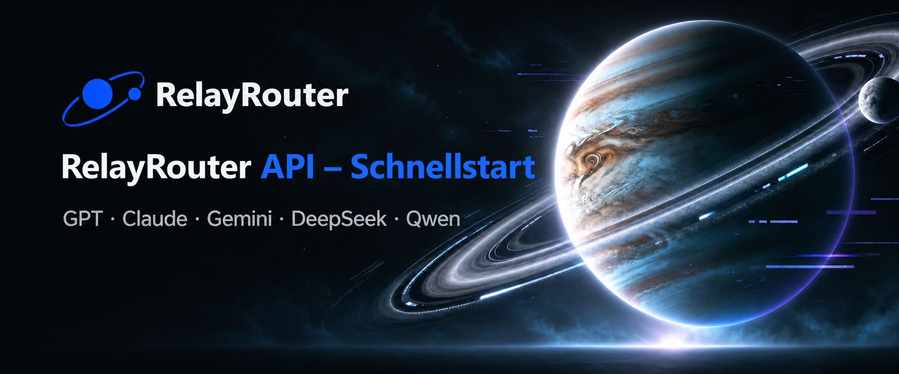
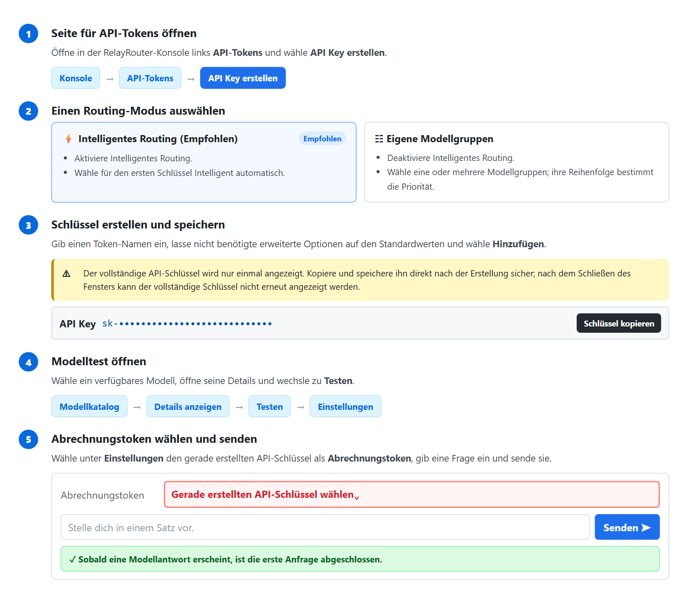
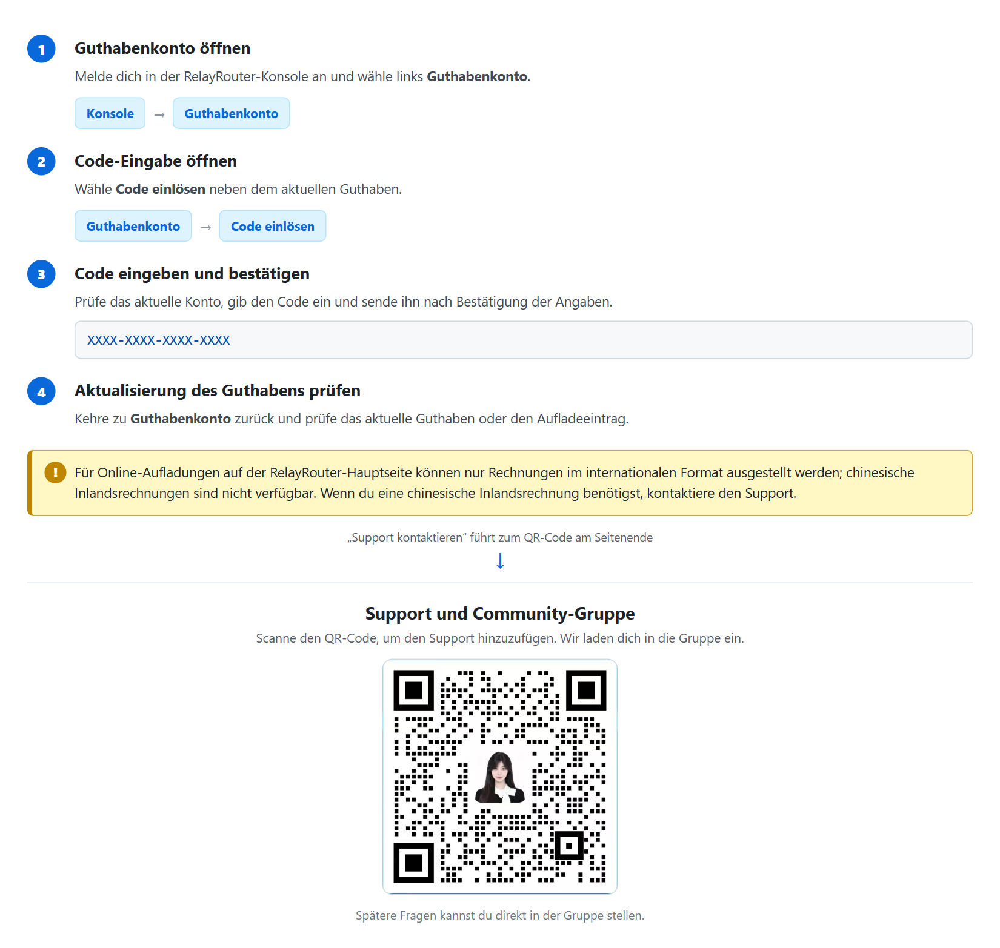
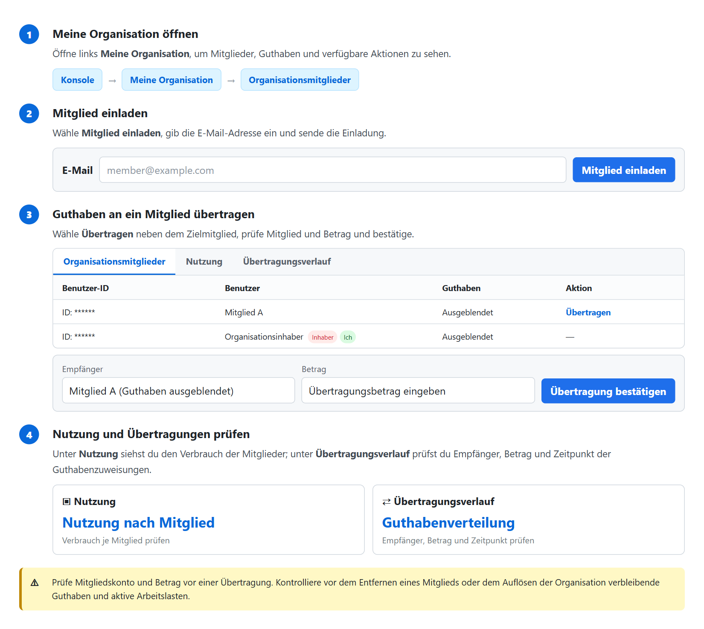
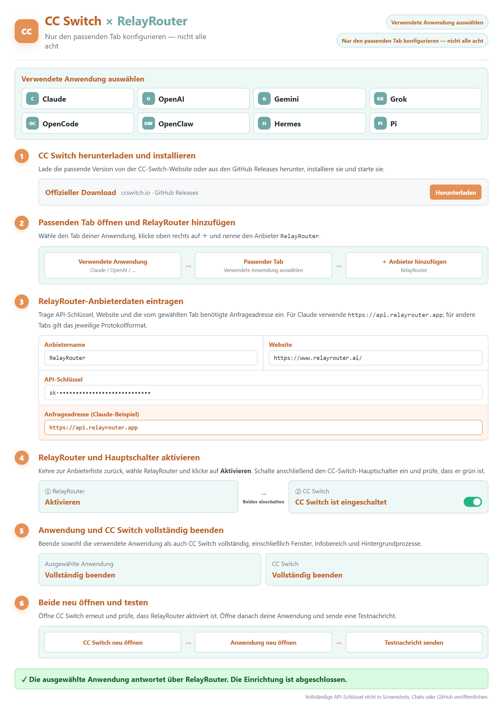
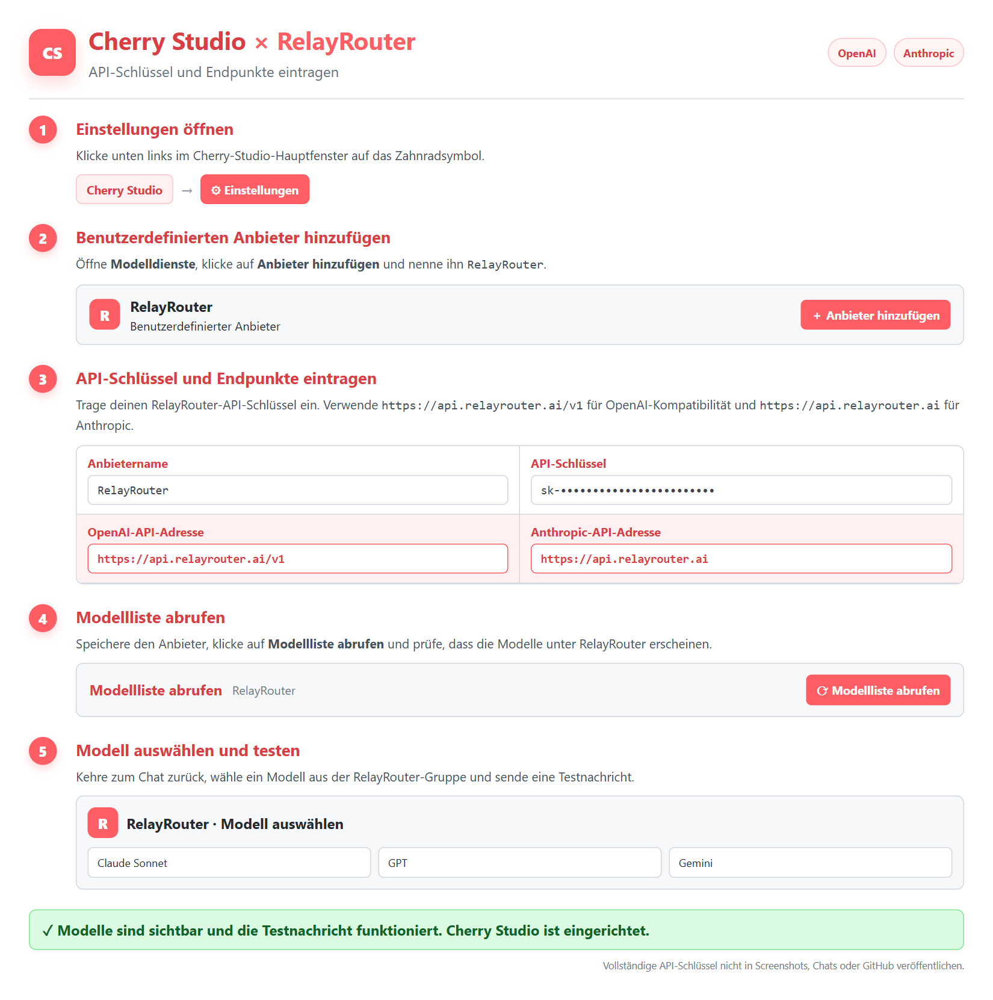
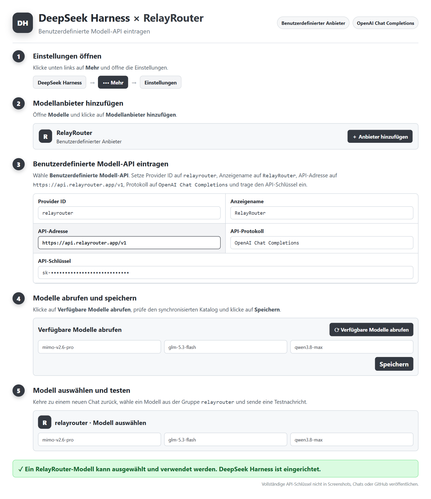

  <a lang="zh-CN" translate="no" href="./README.zh-CN.md">中文 (ZH)</a>
  &nbsp;|&nbsp;
  <a lang="en" translate="no" href="./README.md">English (EN)</a>
  &nbsp;|&nbsp;
  <a lang="ru" translate="no" href="./README.ru.md">Русский (RU)</a>
  &nbsp;|&nbsp;
  <a lang="ko" translate="no" href="./README.ko.md">한국어 (KO)</a>
  &nbsp;|&nbsp;
  <a lang="ja" translate="no" href="./README.ja.md">日本語 (JA)</a>
  &nbsp;|&nbsp;
  <a lang="es" translate="no" href="./README.es.md">Español (ES)</a>
  &nbsp;|&nbsp;
  <strong><a lang="de" translate="no" href="./README.de.md">Deutsch (DE)</a></strong>
  &nbsp;|&nbsp;
  <a lang="id" translate="no" href="./README.id.md">Bahasa Indonesia (ID)</a>

Aktuelle Sprache: Deutsch (DE). Falls der Text in einer anderen Sprache erscheint, deaktiviere die automatische Übersetzung für github.com.

  

  
  &nbsp;&nbsp;
  

  
  
  
  

> 💡 <strong>Tipp:</strong> Die Anmeldung über Drittanbieter wird unterstützt. Wähle auf der Registrierungsseite unten Sign in und danach das Symbol für GitHub, Google oder Linux DO.

<!-- relayrouter-announcements:start -->
> [!IMPORTANT]
> **Neueste Ankündigungen · Automatisch synchronisiert**
>
> Die neuesten 5 RelayRouter-Ankündigungen:
>
> - `2026-11-23 17:25 (UTC+8)` — Benachrichtigung: Ab dem 23. November 2026 um 17:00 Uhr Beijing-Zeit werden Anfragen für gruppierte Zeichnungen von OpenAI und Azure, sobald sie gesendet werden, auch dann berechnet, wenn du die Verbindung vor der Erstellung der Zeichnung aktiv trennst oder a…
> - `2026-11-23 17:01 (UTC+8)` — Modell bereitstellen: minimax-h3-z
> - `2026-11-23 16:48 (UTC+8)` — Benachrichtigung: Aufgrund unzureichender Ressourcen in der Gruppe Xai-Grok-1 werden die Modelle grok-4.7, grok-imagine-image, grok-4-20-reassoning, grok-imagine-image-quality, grok-imagine-image-2.0, grok-imagine-video-1.5-preview, grok-imagine-video, grok-i…
> - `2026-11-21 14:08 (UTC+8)` — Benachrichtigung: In letzter Zeit sind die Ressourcen von gemini-3.8-flash knapp, vorübergehend nicht verfügbar. Nach der Wiederherstellung werden wir gesondert informieren.
> - `2026-11-21 02:33 (UTC+8)` — Benachrichtigung: 【suno-Neuheit】ACE Musikmodell jetzt verfügbar! Behebt die Urheberrechtsbeschränkungen von Suno für Coverversionen, die Coverversionen entsprechen Suno, unterstützt ace-step-1.5-xl /acemusic-v1 /acemusic-v1.1, bietet drei Modi: Inspiration, T…
>
> [RelayRouter öffnen und alle Ankündigungen ansehen →](https://relayrouter.app/register?aff=xc9N)
<!-- relayrouter-announcements:end -->

## Warum RelayRouter?

RelayRouter verbindet mehrere Modellanbieter über eine einzige OpenAI-kompatible API und reduziert wiederkehrende Integrationsarbeit.

| Funktion | Vorteil |
| --- | --- |
| Einheitliches API-Format | GPT, Claude, Gemini, DeepSeek, Qwen und weitere unterstützte Modelle über eine vertraute Schnittstelle. |
| Nutzungsbasierte Abrechnung | Bezahle die in der RelayRouter-Konsole erfasste Nutzung. |
| Zentrale Verwaltung | Verwalte Schlüssel, Modelle, Nutzung und Abrechnung an einem Ort. |
| Organisationsverwaltung | Erstelle eine Organisation, lade Mitglieder ein, verteile Guthaben und prüfe Nutzung und Übertragungen. |
| Flexible Verbindungsadressen | Wenn ein Client ein anderes `BASE_URL`-Format erwartet, probiere die angegebenen Adressen der Reihe nach. |

## Was möchtest du erreichen?

Wähle ein Ziel und springe direkt zur passenden Anleitung. Du musst nicht die gesamte Seite von oben nach unten lesen.

| Ziel | Ziel |
| --- | --- |
| **[Ersten API-Aufruf ausführen →](#first-api-call)** Etwa 5 Minuten · API-Schlüssel → BASE_URL → erste Anfrage | **[Code einlösen und Guthaben prüfen →](#redeem-code)** Etwa 2 Minuten · Guthaben einlösen und Kontostand prüfen |
| **[Team oder Organisation verwalten →](#organization-management)** Etwa 8 Minuten · Erstellen → einladen → verteilen → Nutzung prüfen | **[Client verbinden →](#client-integration)** CC Switch, Cherry Studio und DeepSeek Harness |

## Grundlegende Anleitungen

<strong>🔑 API-Schlüssel erstellen und erste Anfrage senden</strong>

<!-- Source copy for the deterministic tutorial image:

#### 1. Seite für API-Tokens öffnen

Öffne in der RelayRouter-Konsole links **API-Tokens** und wähle **API Key erstellen**.

`Konsole` → `API-Tokens` → **API Key erstellen**

#### 2. Einen Routing-Modus auswählen

| ⚡ Intelligentes Routing (Empfohlen) | ☷ Eigene Modellgruppen |
| --- | --- |
| Aktiviere **Intelligentes Routing**. | Deaktiviere **Intelligentes Routing**. |
| Wähle für den ersten Schlüssel **Intelligent automatisch**. | Wähle eine oder mehrere Modellgruppen; ihre Reihenfolge bestimmt die Priorität. |

#### 3. Schlüssel erstellen und speichern

Gib einen Token-Namen ein, lasse nicht benötigte erweiterte Optionen auf den Standardwerten und wähle **Hinzufügen**.

> [!WARNING]
> Der vollständige API-Schlüssel wird nur einmal angezeigt. Kopiere und speichere ihn direkt nach der Erstellung sicher; nach dem Schließen des Fensters kann der vollständige Schlüssel nicht erneut angezeigt werden.

`API Key`　`sk-****************************`　**Schlüssel kopieren**

#### 4. Modelltest öffnen

Wähle ein verfügbares Modell, öffne seine Details und wechsle zu **Testen**.

`Modellkatalog` → `Details anzeigen` → `Testen` → `Einstellungen`

#### 5. Abrechnungstoken wählen und senden

Wähle unter **Einstellungen** den gerade erstellten API-Schlüssel als **Abrechnungstoken**, gib eine Frage ein und sende sie.

> [!TIP]
> Sobald eine Modellantwort erscheint, ist die erste Anfrage abgeschlossen.

-->

<strong>🎁 Code einlösen und Guthaben prüfen</strong>

<strong><a href="#contact-support">Support kontaktieren</a></strong>

<!-- Source copy for the deterministic tutorial image:

#### 1. Guthabenkonto öffnen

Melde dich in der RelayRouter-Konsole an und wähle links **Guthabenkonto**.

#### 2. Code-Eingabe öffnen

Wähle **Code einlösen** neben dem aktuellen Guthaben.

#### 3. Code eingeben und bestätigen

Prüfe das aktuelle Konto, gib den Code ein und sende ihn nach Bestätigung der Angaben.

#### 4. Aktualisierung des Guthabens prüfen

Kehre zu **Guthabenkonto** zurück und prüfe das aktuelle Guthaben oder den Aufladeeintrag.

> [!IMPORTANT]
> Für Online-Aufladungen auf der RelayRouter-Hauptseite können nur Rechnungen im internationalen Format ausgestellt werden; chinesische Inlandsrechnungen sind nicht verfügbar. Wenn du eine chinesische Inlandsrechnung benötigst, [kontaktiere den Support](#contact-support).

-->

<strong>👥 Organisationsmitglieder und Nutzung verwalten</strong>

<!-- Source copy for the deterministic tutorial image:

#### 1. Meine Organisation öffnen

Öffne links **Meine Organisation**, um Mitglieder, Guthaben und verfügbare Aktionen zu sehen.

`Konsole` → `Meine Organisation` → `Organisationsmitglieder`

#### 2. Mitglied einladen

Wähle **Mitglied einladen**, gib die E-Mail-Adresse ein und sende die Einladung.

`member@example.com`　**Mitglied einladen**

#### 3. Guthaben an ein Mitglied übertragen

Wähle **Übertragen** neben dem Zielmitglied, prüfe Mitglied und Betrag und bestätige.

| Benutzer-ID | Benutzer | Guthaben | Aktion |
| --- | --- | --- | --- |
| `ID: ******` | Mitglied A | Ausgeblendet | **Übertragen** |
| `ID: ******` | Organisationsinhaber | Ausgeblendet | — |

`Empfänger: Mitglied A (Guthaben ausgeblendet)`　`Betrag: Übertragungsbetrag eingeben`　**Übertragung bestätigen**

#### 4. Nutzung und Übertragungen prüfen

Unter **Nutzung** siehst du den Verbrauch der Mitglieder; unter **Übertragungsverlauf** prüfst du Empfänger, Betrag und Zeitpunkt der Guthabenzuweisungen.

> [!CAUTION]
> Prüfe Mitgliedskonto und Betrag vor einer Übertragung. Kontrolliere vor dem Entfernen eines Mitglieds oder dem Auflösen der Organisation verbleibende Guthaben und aktive Arbeitslasten.

-->

## Anleitungen zur Client-Integration

Wähle die Anwendung, die du tatsächlich verwendest. In CC Switch wird nur der passende Anwendungs-Tab konfiguriert; Cherry Studio und DeepSeek Harness haben eigene Abläufe. Die Endpunktformate unterscheiden sich je nach Protokoll; beachte daher auch die [Schnellreferenz](#quick-reference).

<strong>CC Switch — Claude / OpenAI / Gemini / Grok / OpenCode / OpenClaw / Hermes / Pi</strong>

Wenn du eine der oben genannten Anwendungen mit RelayRouter nutzt, konfiguriere nur den zugehörigen Tab in CC Switch. Du musst nicht alle acht einrichten.

#### 1. CC Switch herunterladen und installieren

Lade die passende Version von der CC-Switch-Website oder aus den GitHub Releases herunter, installiere sie und starte sie.

#### 2. Passenden Tab öffnen und RelayRouter hinzufügen

Wähle den Tab deiner Anwendung, klicke oben rechts auf `＋` und nenne den Anbieter `RelayRouter`.

#### 3. RelayRouter-Anbieterdaten eintragen

Trage API-Schlüssel, Website und die vom gewählten Tab benötigte Anfrageadresse ein. Für Claude verwende `https://api.relayrouter.app`; für andere Tabs gilt das jeweilige Protokollformat.

#### 4. RelayRouter und Hauptschalter aktivieren

Kehre zur Anbieterliste zurück, wähle RelayRouter und klicke auf **Aktivieren**. Schalte anschließend den CC-Switch-Hauptschalter ein und prüfe, dass er grün ist.

#### 5. Anwendung und CC Switch vollständig beenden

Beende sowohl die verwendete Anwendung als auch CC Switch vollständig, einschließlich Fenster, Infobereich und Hintergrundprozesse.

#### 6. Beide neu öffnen und testen

Öffne CC Switch erneut und prüfe, dass RelayRouter aktiviert ist. Öffne danach deine Anwendung und sende eine Testnachricht.

<strong>Cherry Studio</strong>

#### 1. Einstellungen öffnen

Klicke unten links im Cherry-Studio-Hauptfenster auf das Zahnradsymbol.

#### 2. Benutzerdefinierten Anbieter hinzufügen

Öffne **Modelldienste**, klicke auf **Anbieter hinzufügen** und nenne ihn `RelayRouter`.

#### 3. API-Schlüssel und Endpunkte eintragen

Trage deinen RelayRouter-API-Schlüssel ein. Verwende `https://api.relayrouter.ai/v1` für OpenAI-Kompatibilität und `https://api.relayrouter.ai` für Anthropic.

#### 4. Modellliste abrufen

Speichere den Anbieter, klicke auf **Modellliste abrufen** und prüfe, dass die Modelle unter RelayRouter erscheinen.

#### 5. Modell auswählen und testen

Kehre zum Chat zurück, wähle ein Modell aus der RelayRouter-Gruppe und sende eine Testnachricht.

<strong>DeepSeek Harness</strong>

#### 1. Einstellungen öffnen

Klicke unten links auf **Mehr** und öffne die Einstellungen.

#### 2. Modellanbieter hinzufügen

Öffne **Modelle** und klicke auf **Modellanbieter hinzufügen**.

#### 3. Benutzerdefinierte Modell-API eintragen

Wähle **Benutzerdefinierte Modell-API**. Setze Provider ID auf `relayrouter`, Anzeigename auf `RelayRouter`, API-Adresse auf `https://api.relayrouter.app/v1`, Protokoll auf `OpenAI Chat Completions` und trage den API-Schlüssel ein.

#### 4. Modelle abrufen und speichern

Klicke auf **Verfügbare Modelle abrufen**, prüfe den synchronisierten Katalog und klicke auf **Speichern**.

#### 5. Modell auswählen und testen

Kehre zu einem neuen Chat zurück, wähle ein Modell aus der Gruppe `relayrouter` und sende eine Testnachricht.

## Schnellreferenz

Verschiedene Clients können unterschiedliche `BASE_URL`-Formate benötigen. Probiere diese Adressen der Reihe nach:

1. `https://api.relayrouter.app`
2. `https://api.relayrouter.app/v1`
3. `https://api.relayrouter.app/v1/chat/completions`

Die SDK-Beispiele in diesem Repository verwenden standardmäßig `https://api.relayrouter.app/v1`. Wenn der Client die vollständige Adresse der Chat-Methode verlangt, verwende die dritte Option.

## Sofort ausführbare Beispiele

| Sprache | Datei | Ausführungsbefehl |
| --- | --- | --- |
| Python | [`examples/python/chat.py`](./examples/python/chat.py) | `python examples/python/chat.py` |
| JavaScript | [`examples/javascript/chat.mjs`](./examples/javascript/chat.mjs) | `node examples/javascript/chat.mjs` |
| PowerShell | [`examples/powershell/request.ps1`](./examples/powershell/request.ps1) | `pwsh examples/powershell/request.ps1` |

## Dokumentation und Sicherheit

- [Ausführlicher Schnellstart](./docs/quickstart.md)
- [Häufige Fragen](./docs/faq.md)
- [Fehlerbehebung](./docs/troubleshooting.md)
- [Sicherheitsrichtlinie](./SECURITY.md)

Übertrage deinen API-Schlüssel niemals an Git. Bewahre ihn in `.env` oder im Secret Manager deiner Plattform auf.

<strong>Ein API-Schlüssel. Mehr Modelle. Weniger Integrationsarbeit.</strong>

  

Scanne den QR-Code, um unseren Supportkontakt hinzuzufügen. Wir laden dich anschließend in die Benutzergruppe ein, in der du weitere Fragen direkt stellen kannst.

