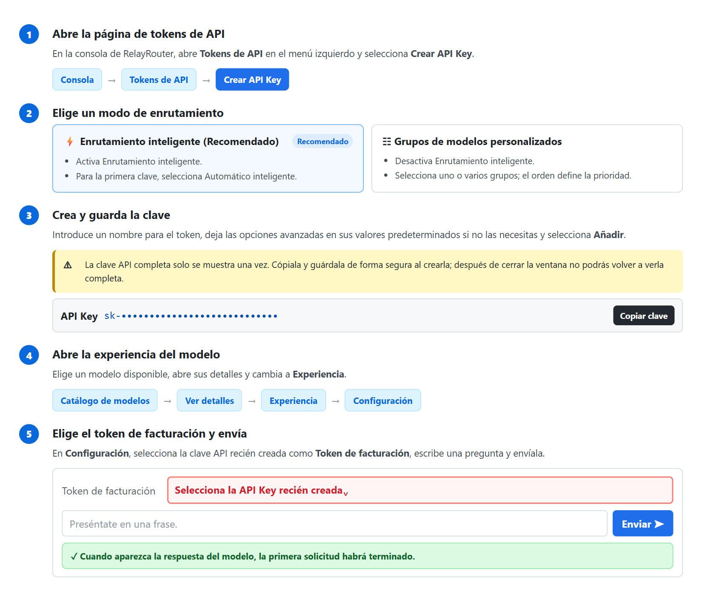
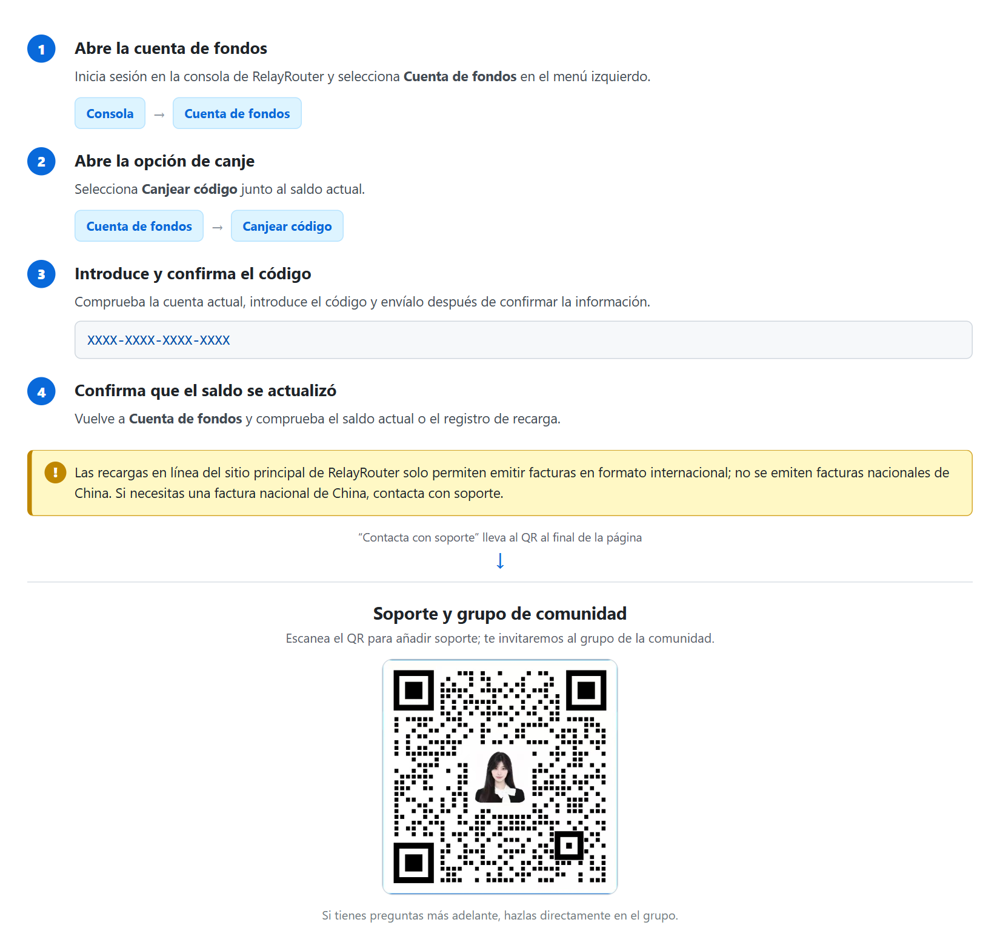
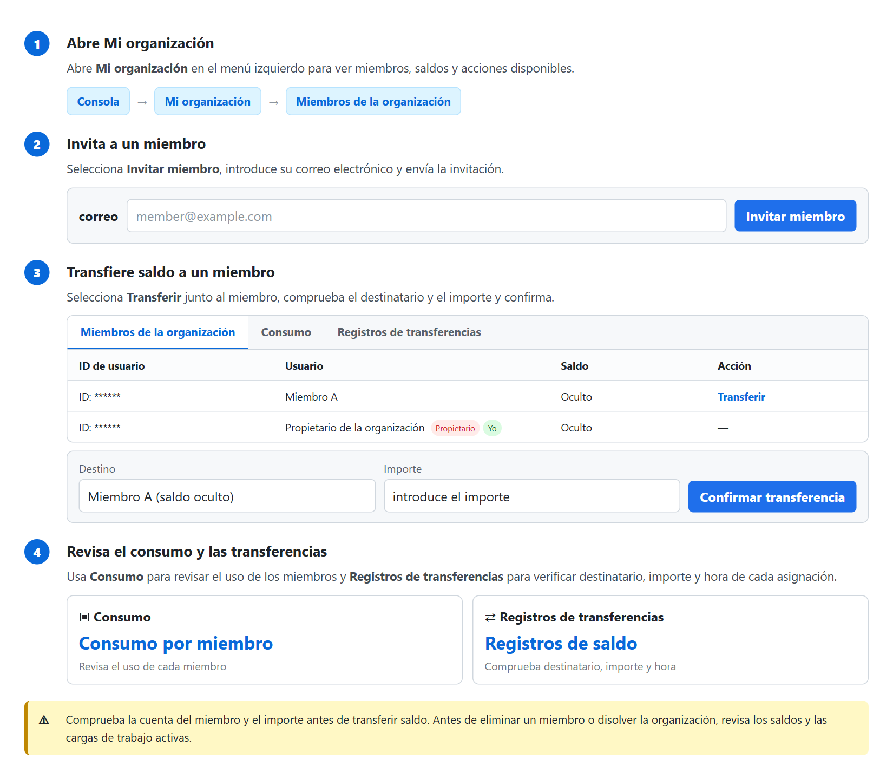
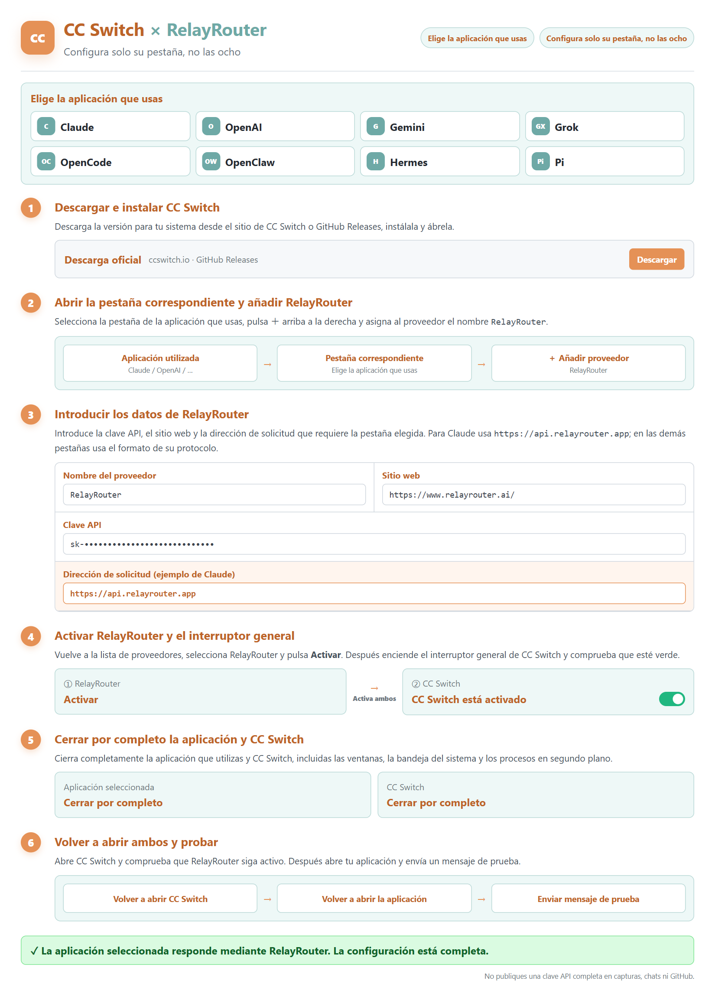
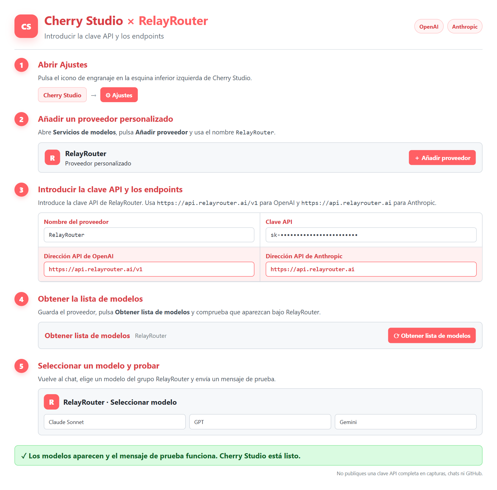
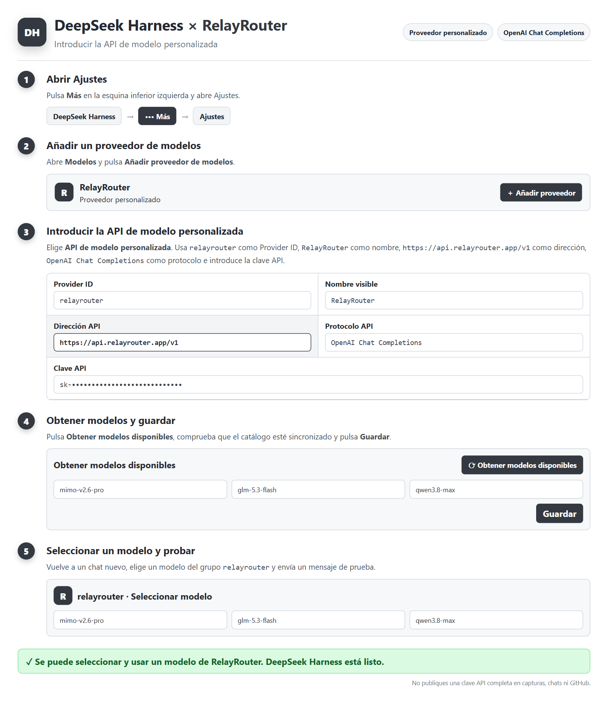

  <a lang="zh-CN" translate="no" href="./README.zh-CN.md">中文 (ZH)</a>
  &nbsp;|&nbsp;
  <a lang="en" translate="no" href="./README.md">English (EN)</a>
  &nbsp;|&nbsp;
  <a lang="ru" translate="no" href="./README.ru.md">Русский (RU)</a>
  &nbsp;|&nbsp;
  <a lang="ko" translate="no" href="./README.ko.md">한국어 (KO)</a>
  &nbsp;|&nbsp;
  <a lang="ja" translate="no" href="./README.ja.md">日本語 (JA)</a>
  &nbsp;|&nbsp;
  <strong><a lang="es" translate="no" href="./README.es.md">Español (ES)</a></strong>
  &nbsp;|&nbsp;
  <a lang="de" translate="no" href="./README.de.md">Deutsch (DE)</a>
  &nbsp;|&nbsp;
  <a lang="id" translate="no" href="./README.id.md">Bahasa Indonesia (ID)</a>

Idioma actual: Español (ES). Si el texto aparece en otro idioma, desactiva la traducción automática para github.com.

  

  
  &nbsp;&nbsp;
  

  
  
  
  

> 💡 <strong>Consejo:</strong> Se admite el inicio de sesión con terceros. En la página de registro, selecciona Sign in en la parte inferior y luego el icono de GitHub, Google o Linux DO.

<!-- relayrouter-announcements:start -->
> [!IMPORTANT]
> **Últimos avisos · Sincronización automática**
>
> Los 5 avisos más recientes de RelayRouter:
>
> - `2026-11-21 14:08 (UTC+8)` — Notificación: recientemente, los recursos de gemini-3.8-flash son escasos, se han retirado temporalmente, se notificará cuando se restablezcan.
> - `2026-11-21 02:33 (UTC+8)` — Notificación: 【suno-上新】 ¡El modelo de música ACE está en línea! Resuelve la interceptación de derechos de autor de Suno, el efecto de la versión es comparable a Suno, soporta ace-step-1.5-xl /acemusic-v1 /acemusic-v1.1, ofrece tres modos: inspiración, letras …
> - `2026-11-20 19:48 (UTC+8)` — Notificación: Qwen4-Max ahora ha sincronizado la valoración de caché oficial, soporta la función de caché de sugerencias. La escritura en caché se cobra en dos niveles: 5 minutos de caché a 1.25 veces el precio de entrada, 1 hora de caché a 2 veces el precio …
> - `2026-11-20 19:47 (UTC+8)` — Notificación: Debido a la falta de recursos de gemini-4-argon, se ha retirado temporalmente para mantenimiento. Se notificará la recuperación una vez que los recursos estén disponibles.
> - `2026-11-20 17:21 (UTC+8)` — Notificación: Vertex-Gemini-1, el grupo Aistudio-Gemini-1 se desconectará el 20 de noviembre a las 20:00, el tiempo de recuperación se notificará.
>
> [Abrir RelayRouter y ver todos los avisos →](https://relayrouter.app/register?aff=xc9N)
<!-- relayrouter-announcements:end -->

## ¿Por qué RelayRouter?

RelayRouter ofrece una API compatible con OpenAI para varios proveedores de modelos y reduce el trabajo de integración repetido.

| Función | Ventaja |
| --- | --- |
| Un formato de API | Usa GPT, Claude, Gemini, DeepSeek, Qwen y otros modelos compatibles con una interfaz conocida. |
| Pago por uso | Paga por el consumo registrado en la consola de RelayRouter. |
| Gestión centralizada | Administra claves, modelos, consumo y facturación en un solo lugar. |
| Gestión de organizaciones | Crea una organización, invita miembros, asigna saldo y revisa el consumo y las transferencias. |
| Direcciones flexibles | Si un cliente espera otro formato de `BASE_URL`, prueba las direcciones indicadas en orden. |

## ¿Qué quieres conseguir?

Elige un objetivo y ve directamente a su tutorial. No es necesario leer toda la página desde el principio.

| Objetivo | Objetivo |
| --- | --- |
| **[Realizar la primera llamada API →](#first-api-call)** Unos 5 minutos · Clave API → BASE_URL → primera solicitud | **[Canjear un código y consultar el saldo →](#redeem-code)** Unos 2 minutos · Canjea crédito y verifica el saldo |
| **[Gestionar un equipo u organización →](#organization-management)** Unos 8 minutos · Crear → invitar → asignar → revisar consumo | **[Conectar un cliente →](#client-integration)** CC Switch, Cherry Studio y DeepSeek Harness |

## Tutoriales básicos

<strong>🔑 Crear una clave API y realizar la primera solicitud</strong>

<!-- Source copy for the deterministic tutorial image:

#### 1. Abre la página de tokens de API

En la consola de RelayRouter, abre **Tokens de API** en el menú izquierdo y selecciona **Crear API Key**.

`Consola` → `Tokens de API` → **Crear API Key**

#### 2. Elige un modo de enrutamiento

| ⚡ Enrutamiento inteligente (Recomendado) | ☷ Grupos de modelos personalizados |
| --- | --- |
| Activa **Enrutamiento inteligente**. | Desactiva **Enrutamiento inteligente**. |
| Para la primera clave, selecciona **Automático inteligente**. | Selecciona uno o varios grupos; el orden define la prioridad. |

#### 3. Crea y guarda la clave

Introduce un nombre para el token, deja las opciones avanzadas en sus valores predeterminados si no las necesitas y selecciona **Añadir**.

> [!WARNING]
> La clave API completa solo se muestra una vez. Cópiala y guárdala de forma segura al crearla; después de cerrar la ventana no podrás volver a verla completa.

`API Key`　`sk-****************************`　**Copiar clave**

#### 4. Abre la experiencia del modelo

Elige un modelo disponible, abre sus detalles y cambia a **Experiencia**.

`Catálogo de modelos` → `Ver detalles` → `Experiencia` → `Configuración`

#### 5. Elige el token de facturación y envía

En **Configuración**, selecciona la clave API recién creada como **Token de facturación**, escribe una pregunta y envíala.

> [!TIP]
> Cuando aparezca la respuesta del modelo, la primera solicitud habrá terminado.

-->

<strong>🎁 Canjear un código y comprobar el saldo</strong>

<strong><a href="#contact-support">Contactar con soporte</a></strong>

<!-- Source copy for the deterministic tutorial image:

#### 1. Abre la cuenta de fondos

Inicia sesión en la consola de RelayRouter y selecciona **Cuenta de fondos** en el menú izquierdo.

#### 2. Abre la opción de canje

Selecciona **Canjear código** junto al saldo actual.

#### 3. Introduce y confirma el código

Comprueba la cuenta actual, introduce el código y envíalo después de confirmar la información.

#### 4. Confirma que el saldo se actualizó

Vuelve a **Cuenta de fondos** y comprueba el saldo actual o el registro de recarga.

> [!IMPORTANT]
> Las recargas en línea del sitio principal de RelayRouter solo permiten emitir facturas en formato internacional; no se emiten facturas nacionales de China. Si necesitas una factura nacional de China, [contacta con soporte](#contact-support).

-->

<strong>👥 Gestionar miembros y consumo de la organización</strong>

<!-- Source copy for the deterministic tutorial image:

#### 1. Abre Mi organización

Abre **Mi organización** en el menú izquierdo para ver miembros, saldos y acciones disponibles.

`Consola` → `Mi organización` → `Miembros de la organización`

#### 2. Invita a un miembro

Selecciona **Invitar miembro**, introduce su correo electrónico y envía la invitación.

`member@example.com`　**Invitar miembro**

#### 3. Transfiere saldo a un miembro

Selecciona **Transferir** junto al miembro, comprueba el destinatario y el importe y confirma.

| ID de usuario | Usuario | Saldo | Acción |
| --- | --- | --- | --- |
| `ID: ******` | Miembro A | Oculto | **Transferir** |
| `ID: ******` | Propietario de la organización | Oculto | — |

`Destino: Miembro A (saldo oculto)`　`Importe: introduce el importe`　**Confirmar transferencia**

#### 4. Revisa el consumo y las transferencias

Usa **Consumo** para revisar el uso de los miembros y **Registros de transferencias** para verificar destinatario, importe y hora de cada asignación.

> [!CAUTION]
> Comprueba la cuenta del miembro y el importe antes de transferir saldo. Antes de eliminar un miembro o disolver la organización, revisa los saldos y las cargas de trabajo activas.

-->

## Tutoriales de integración con clientes

Elige la aplicación que utilizas. En CC Switch solo debes configurar la pestaña correspondiente; Cherry Studio y DeepSeek Harness tienen flujos propios. El formato del endpoint depende del protocolo, así que consulta también la [referencia rápida](#quick-reference).

<strong>CC Switch — Claude / OpenAI / Gemini / Grok / OpenCode / OpenClaw / Hermes / Pi</strong>

Si usas una de las aplicaciones anteriores con RelayRouter, configura solo su pestaña en CC Switch. No necesitas configurar las ocho.

#### 1. Descargar e instalar CC Switch

Descarga la versión para tu sistema desde el sitio de CC Switch o GitHub Releases, instálala y ábrela.

#### 2. Abrir la pestaña correspondiente y añadir RelayRouter

Selecciona la pestaña de la aplicación que usas, pulsa `＋` arriba a la derecha y asigna al proveedor el nombre `RelayRouter`.

#### 3. Introducir los datos de RelayRouter

Introduce la clave API, el sitio web y la dirección de solicitud que requiere la pestaña elegida. Para Claude usa `https://api.relayrouter.app`; en las demás pestañas usa el formato de su protocolo.

#### 4. Activar RelayRouter y el interruptor general

Vuelve a la lista de proveedores, selecciona RelayRouter y pulsa **Activar**. Después enciende el interruptor general de CC Switch y comprueba que esté verde.

#### 5. Cerrar por completo la aplicación y CC Switch

Cierra completamente la aplicación que utilizas y CC Switch, incluidas las ventanas, la bandeja del sistema y los procesos en segundo plano.

#### 6. Volver a abrir ambos y probar

Abre CC Switch y comprueba que RelayRouter siga activo. Después abre tu aplicación y envía un mensaje de prueba.

<strong>Cherry Studio</strong>

#### 1. Abrir Ajustes

Pulsa el icono de engranaje en la esquina inferior izquierda de Cherry Studio.

#### 2. Añadir un proveedor personalizado

Abre **Servicios de modelos**, pulsa **Añadir proveedor** y usa el nombre `RelayRouter`.

#### 3. Introducir la clave API y los endpoints

Introduce la clave API de RelayRouter. Usa `https://api.relayrouter.ai/v1` para OpenAI y `https://api.relayrouter.ai` para Anthropic.

#### 4. Obtener la lista de modelos

Guarda el proveedor, pulsa **Obtener lista de modelos** y comprueba que aparezcan bajo RelayRouter.

#### 5. Seleccionar un modelo y probar

Vuelve al chat, elige un modelo del grupo RelayRouter y envía un mensaje de prueba.

<strong>DeepSeek Harness</strong>

#### 1. Abrir Ajustes

Pulsa **Más** en la esquina inferior izquierda y abre Ajustes.

#### 2. Añadir un proveedor de modelos

Abre **Modelos** y pulsa **Añadir proveedor de modelos**.

#### 3. Introducir la API de modelo personalizada

Elige **API de modelo personalizada**. Usa `relayrouter` como Provider ID, `RelayRouter` como nombre, `https://api.relayrouter.app/v1` como dirección, `OpenAI Chat Completions` como protocolo e introduce la clave API.

#### 4. Obtener modelos y guardar

Pulsa **Obtener modelos disponibles**, comprueba que el catálogo esté sincronizado y pulsa **Guardar**.

#### 5. Seleccionar un modelo y probar

Vuelve a un chat nuevo, elige un modelo del grupo `relayrouter` y envía un mensaje de prueba.

## Referencia rápida

Cada cliente puede requerir un formato de `BASE_URL` diferente. Prueba estas direcciones en orden:

1. `https://api.relayrouter.app`
2. `https://api.relayrouter.app/v1`
3. `https://api.relayrouter.app/v1/chat/completions`

Los ejemplos de SDK de este repositorio usan `https://api.relayrouter.app/v1` de forma predeterminada. Si el cliente solicita la dirección completa del método de chat, usa la tercera opción.

## Ejemplos listos para usar

| Lenguaje | Archivo | Comando de ejecución |
| --- | --- | --- |
| Python | [`examples/python/chat.py`](./examples/python/chat.py) | `python examples/python/chat.py` |
| JavaScript | [`examples/javascript/chat.mjs`](./examples/javascript/chat.mjs) | `node examples/javascript/chat.mjs` |
| PowerShell | [`examples/powershell/request.ps1`](./examples/powershell/request.ps1) | `pwsh examples/powershell/request.ps1` |

## Documentación y seguridad

- [Inicio rápido detallado](./docs/quickstart.md)
- [Preguntas frecuentes](./docs/faq.md)
- [Solución de problemas](./docs/troubleshooting.md)
- [Política de seguridad](./SECURITY.md)

No subas tu clave API a Git. Guárdala en `.env` o en el gestor de secretos de tu plataforma.

<strong>Una clave API. Más modelos. Menos integración.</strong>

  

Escanea el código QR para añadir a nuestro contacto de soporte. Te invitaremos al grupo de usuarios, donde podrás consultar directamente cualquier duda posterior.

