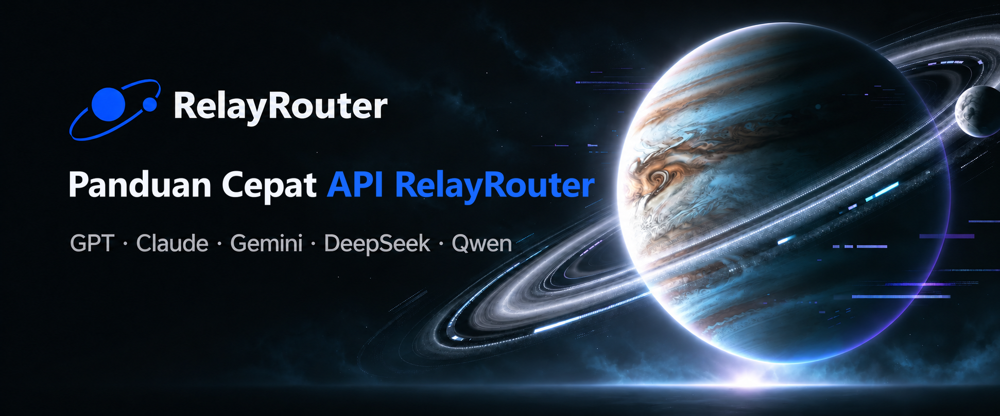
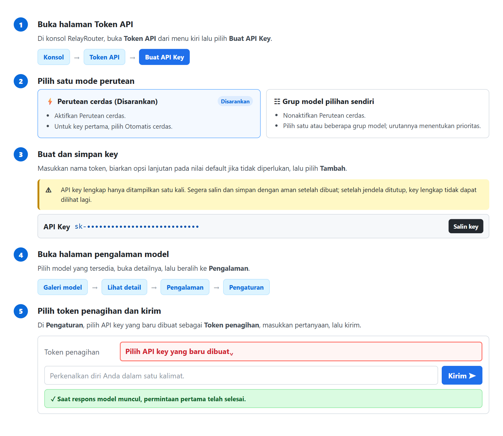
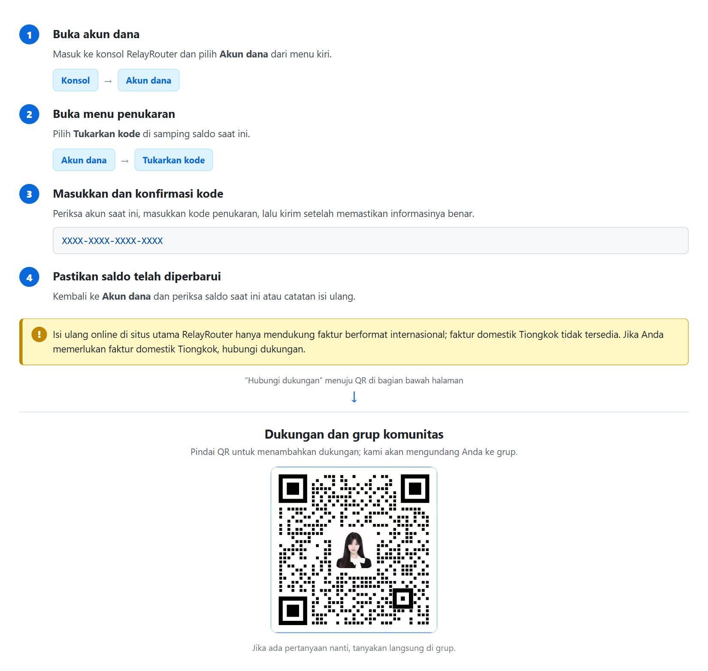
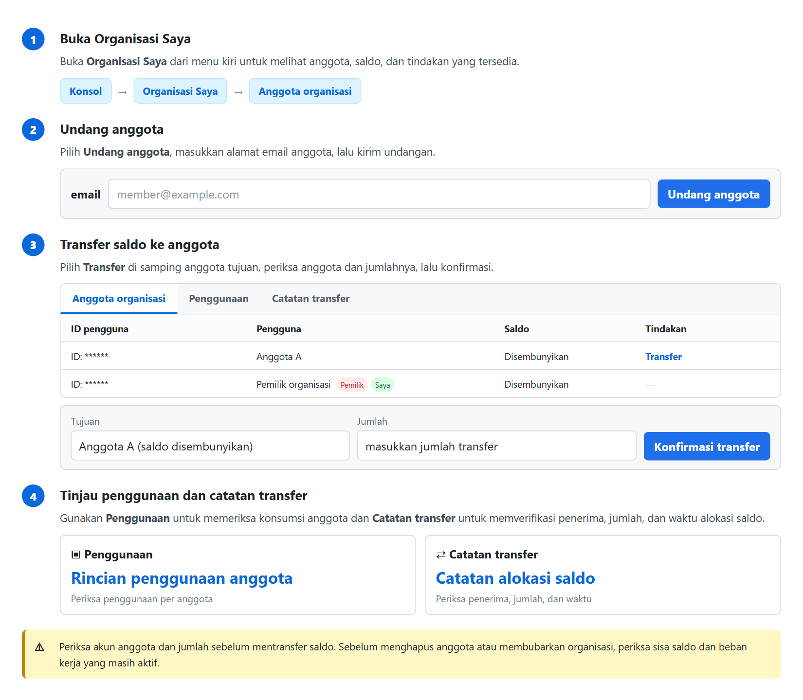
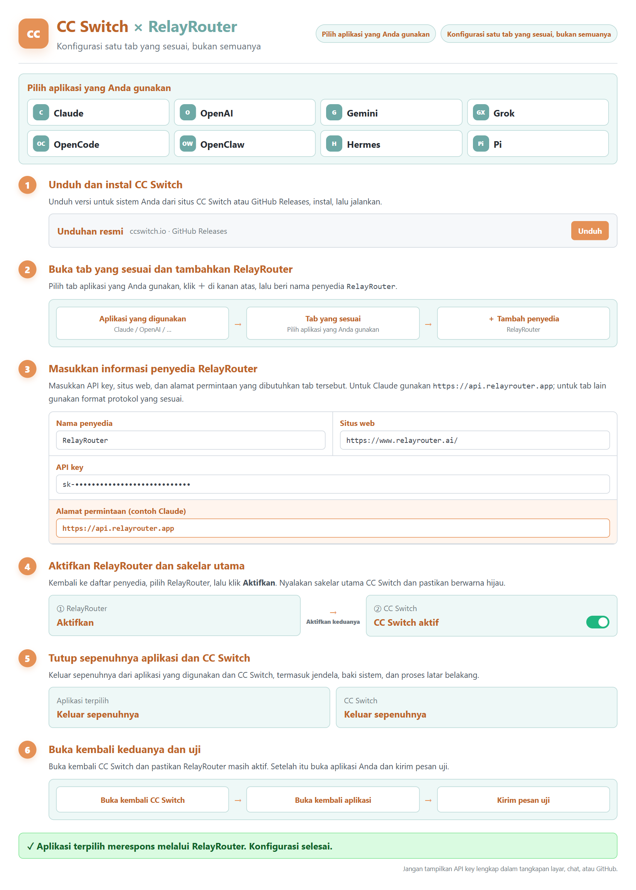
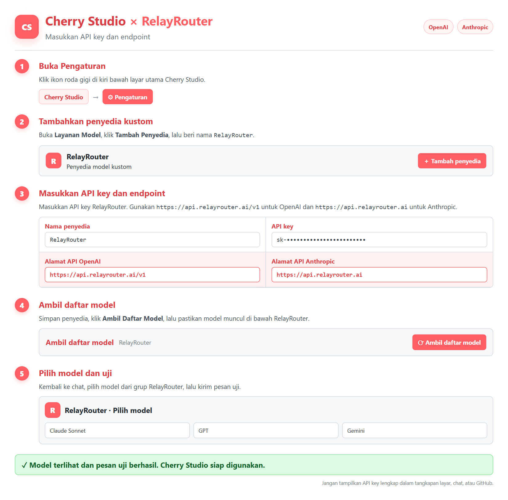
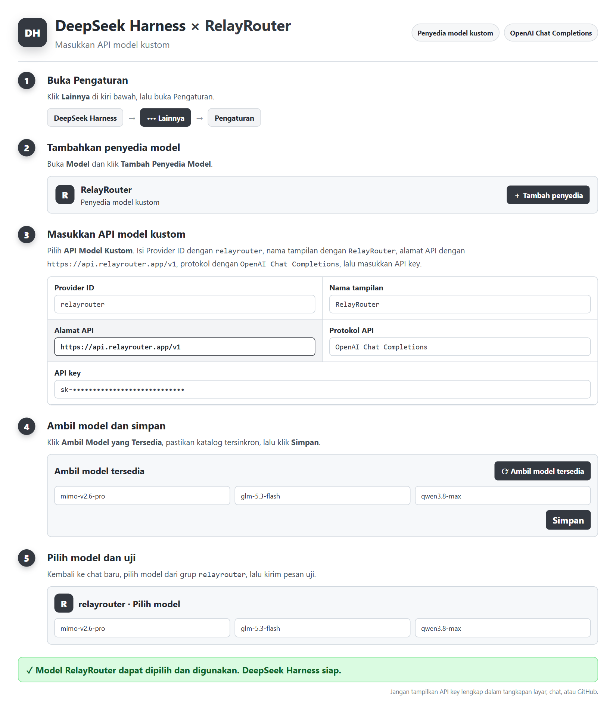

  <a lang="zh-CN" translate="no" href="./README.zh-CN.md">中文 (ZH)</a>
  &nbsp;|&nbsp;
  <a lang="en" translate="no" href="./README.md">English (EN)</a>
  &nbsp;|&nbsp;
  <a lang="ru" translate="no" href="./README.ru.md">Русский (RU)</a>
  &nbsp;|&nbsp;
  <a lang="ko" translate="no" href="./README.ko.md">한국어 (KO)</a>
  &nbsp;|&nbsp;
  <a lang="ja" translate="no" href="./README.ja.md">日本語 (JA)</a>
  &nbsp;|&nbsp;
  <a lang="es" translate="no" href="./README.es.md">Español (ES)</a>
  &nbsp;|&nbsp;
  <a lang="de" translate="no" href="./README.de.md">Deutsch (DE)</a>
  &nbsp;|&nbsp;
  <strong><a lang="id" translate="no" href="./README.id.md">Bahasa Indonesia (ID)</a></strong>

Bahasa saat ini: Bahasa Indonesia (ID). Jika teks muncul dalam bahasa lain, nonaktifkan terjemahan otomatis untuk github.com.

  

  
  &nbsp;&nbsp;
  

  
  
  
  

> 💡 <strong>Kiat:</strong> Login dengan akun pihak ketiga didukung. Pada halaman pendaftaran, pilih Sign in di bagian bawah, lalu pilih ikon GitHub, Google, atau Linux DO pada halaman login.

<!-- relayrouter-announcements:start -->
> [!IMPORTANT]
> **Pengumuman terbaru · Sinkronisasi otomatis**
>
> 5 pengumuman RelayRouter terbaru:
>
> - `2026-11-20 19:48 (UTC+8)` — Notice: Qwen4-Max has now synchronized the official cache pricing, supporting the prompt caching feature. Cache writing is billed in two tiers: 5-minute cache at 1.25 times the input price, and 1-hour cache at 2 times the input price, with cache hits billed a…
> - `2026-11-20 19:47 (UTC+8)` — Notice: Due to insufficient resources for gemini-4-argon, it has been temporarily taken down for maintenance. We will notify you when resources are sufficient to restore it.
> - `2026-11-20 17:21 (UTC+8)` — Notice: Vertex-Gemini-1 and Aistudio-Gemini-1 groups will go offline at 8 PM Beijing time on November 20th, recovery time will be notified later
> - `2026-11-20 16:44 (UTC+8)` — Notice: Recently, the resources for gemini-embedding-001 and gemini-embedding-2-preview are in short supply, resulting in a high failure rate for requests. They are temporarily taken down and will be restored with further notice. We apologize for the inconven…
> - `2026-11-20 14:17 (UTC+8)` — Model Release: scribe_v2, scribe_v3
>
> _Sumber belum menyediakan terjemahan Bahasa Indonesia; pengumuman ditampilkan dalam bahasa Inggris._
>
> [Buka RelayRouter dan lihat semua pengumuman →](https://relayrouter.app/register?aff=xc9N)
<!-- relayrouter-announcements:end -->

## Mengapa RelayRouter?

RelayRouter menyediakan satu API yang kompatibel dengan OpenAI untuk berbagai penyedia model, sehingga pekerjaan integrasi berulang menjadi lebih sedikit.

| Kemampuan | Manfaat |
| --- | --- |
| Satu format API | Gunakan GPT, Claude, Gemini, DeepSeek, Qwen, dan model lain yang didukung melalui antarmuka yang familier. |
| Bayar sesuai penggunaan | Bayar berdasarkan penggunaan yang tercatat di konsol RelayRouter. |
| Pengelolaan terpusat | Kelola API key, akses model, penggunaan, dan tagihan di satu tempat. |
| Pengelolaan organisasi | Buat organisasi, undang anggota, alokasikan saldo, serta tinjau penggunaan dan catatan transfer. |
| Alamat koneksi fleksibel | Jika klien mengharapkan format `BASE_URL` lain, coba alamat yang tersedia secara berurutan. |

## Apa yang ingin Anda selesaikan?

Pilih tujuan dan langsung buka tutorial terkait. Anda tidak perlu membaca seluruh halaman dari awal.

| Tujuan | Tujuan |
| --- | --- |
| **[Lakukan panggilan API pertama →](#first-api-call)** Sekitar 5 menit · API key → BASE_URL → permintaan pertama | **[Tukarkan kode dan periksa saldo →](#redeem-code)** Sekitar 2 menit · Tukarkan kredit dan verifikasi saldo |
| **[Kelola tim atau organisasi →](#organization-management)** Sekitar 8 menit · Buat → undang → alokasikan → tinjau penggunaan | **[Hubungkan klien →](#client-integration)** CC Switch, Cherry Studio, dan DeepSeek Harness |

## Tutorial dasar

<strong>🔑 Buat API key dan kirim permintaan pertama</strong>

<!-- Source copy for the deterministic tutorial image:

#### 1. Buka halaman Token API

Di konsol RelayRouter, buka **Token API** dari menu kiri lalu pilih **Buat API Key**.

`Konsol` → `Token API` → **Buat API Key**

#### 2. Pilih satu mode perutean

| ⚡ Perutean cerdas (Disarankan) | ☷ Grup model pilihan sendiri |
| --- | --- |
| Aktifkan **Perutean cerdas**. | Nonaktifkan **Perutean cerdas**. |
| Untuk key pertama, pilih **Otomatis cerdas**. | Pilih satu atau beberapa grup model; urutannya menentukan prioritas. |

#### 3. Buat dan simpan key

Masukkan nama token, biarkan opsi lanjutan pada nilai default jika tidak diperlukan, lalu pilih **Tambah**.

> [!WARNING]
> API key lengkap hanya ditampilkan satu kali. Segera salin dan simpan dengan aman setelah dibuat; setelah jendela ditutup, key lengkap tidak dapat dilihat lagi.

`API Key`　`sk-****************************`　**Salin key**

#### 4. Buka halaman pengalaman model

Pilih model yang tersedia, buka detailnya, lalu beralih ke **Pengalaman**.

`Galeri model` → `Lihat detail` → `Pengalaman` → `Pengaturan`

#### 5. Pilih token penagihan dan kirim

Di **Pengaturan**, pilih API key yang baru dibuat sebagai **Token penagihan**, masukkan pertanyaan, lalu kirim.

> [!TIP]
> Saat respons model muncul, permintaan pertama telah selesai.

-->

<strong>🎁 Tukarkan kode dan periksa saldo</strong>

<strong><a href="#contact-support">Hubungi dukungan</a></strong>

<!-- Source copy for the deterministic tutorial image:

#### 1. Buka akun dana

Masuk ke konsol RelayRouter dan pilih **Akun dana** dari menu kiri.

#### 2. Buka menu penukaran

Pilih **Tukarkan kode** di samping saldo saat ini.

#### 3. Masukkan dan konfirmasi kode

Periksa akun saat ini, masukkan kode penukaran, lalu kirim setelah memastikan informasinya benar.

#### 4. Pastikan saldo telah diperbarui

Kembali ke **Akun dana** dan periksa saldo saat ini atau catatan isi ulang.

> [!IMPORTANT]
> Isi ulang online di situs utama RelayRouter hanya mendukung faktur berformat internasional; faktur domestik Tiongkok tidak tersedia. Jika Anda memerlukan faktur domestik Tiongkok, [hubungi dukungan](#contact-support).

-->

<strong>👥 Kelola anggota dan penggunaan organisasi</strong>

<!-- Source copy for the deterministic tutorial image:

#### 1. Buka Organisasi Saya

Buka **Organisasi Saya** dari menu kiri untuk melihat anggota, saldo, dan tindakan yang tersedia.

`Konsol` → `Organisasi Saya` → `Anggota organisasi`

#### 2. Undang anggota

Pilih **Undang anggota**, masukkan alamat email anggota, lalu kirim undangan.

`member@example.com`　**Undang anggota**

#### 3. Transfer saldo ke anggota

Pilih **Transfer** di samping anggota tujuan, periksa anggota dan jumlahnya, lalu konfirmasi.

| ID pengguna | Pengguna | Saldo | Tindakan |
| --- | --- | --- | --- |
| `ID: ******` | Anggota A | Disembunyikan | **Transfer** |
| `ID: ******` | Pemilik organisasi | Disembunyikan | — |

`Tujuan: Anggota A (saldo disembunyikan)`　`Jumlah: masukkan jumlah transfer`　**Konfirmasi transfer**

#### 4. Tinjau penggunaan dan catatan transfer

Gunakan **Penggunaan** untuk memeriksa konsumsi anggota dan **Catatan transfer** untuk memverifikasi penerima, jumlah, dan waktu alokasi saldo.

> [!CAUTION]
> Periksa akun anggota dan jumlah sebelum mentransfer saldo. Sebelum menghapus anggota atau membubarkan organisasi, periksa sisa saldo dan beban kerja yang masih aktif.

-->

## Tutorial integrasi klien

Pilih aplikasi yang benar-benar Anda gunakan. Di CC Switch, cukup konfigurasi tab aplikasi yang sesuai; Cherry Studio dan DeepSeek Harness memiliki alur sendiri. Format endpoint berbeda menurut protokol, jadi lihat juga [referensi cepat](#quick-reference).

<strong>CC Switch — Claude / OpenAI / Gemini / Grok / OpenCode / OpenClaw / Hermes / Pi</strong>

Jika Anda memakai salah satu aplikasi di atas dengan RelayRouter, konfigurasi hanya tab yang sesuai di CC Switch. Anda tidak perlu mengatur kedelapannya.

#### 1. Unduh dan instal CC Switch

Unduh versi untuk sistem Anda dari situs CC Switch atau GitHub Releases, instal, lalu jalankan.

#### 2. Buka tab yang sesuai dan tambahkan RelayRouter

Pilih tab aplikasi yang Anda gunakan, klik `＋` di kanan atas, lalu beri nama penyedia `RelayRouter`.

#### 3. Masukkan informasi penyedia RelayRouter

Masukkan API key, situs web, dan alamat permintaan yang dibutuhkan tab tersebut. Untuk Claude gunakan `https://api.relayrouter.app`; untuk tab lain gunakan format protokol yang sesuai.

#### 4. Aktifkan RelayRouter dan sakelar utama

Kembali ke daftar penyedia, pilih RelayRouter, lalu klik **Aktifkan**. Nyalakan sakelar utama CC Switch dan pastikan berwarna hijau.

#### 5. Tutup sepenuhnya aplikasi dan CC Switch

Keluar sepenuhnya dari aplikasi yang digunakan dan CC Switch, termasuk jendela, baki sistem, dan proses latar belakang.

#### 6. Buka kembali keduanya dan uji

Buka kembali CC Switch dan pastikan RelayRouter masih aktif. Setelah itu buka aplikasi Anda dan kirim pesan uji.

<strong>Cherry Studio</strong>

#### 1. Buka Pengaturan

Klik ikon roda gigi di kiri bawah layar utama Cherry Studio.

#### 2. Tambahkan penyedia kustom

Buka **Layanan Model**, klik **Tambah Penyedia**, lalu beri nama `RelayRouter`.

#### 3. Masukkan API key dan endpoint

Masukkan API key RelayRouter. Gunakan `https://api.relayrouter.ai/v1` untuk OpenAI dan `https://api.relayrouter.ai` untuk Anthropic.

#### 4. Ambil daftar model

Simpan penyedia, klik **Ambil Daftar Model**, lalu pastikan model muncul di bawah RelayRouter.

#### 5. Pilih model dan uji

Kembali ke chat, pilih model dari grup RelayRouter, lalu kirim pesan uji.

<strong>DeepSeek Harness</strong>

#### 1. Buka Pengaturan

Klik **Lainnya** di kiri bawah, lalu buka Pengaturan.

#### 2. Tambahkan penyedia model

Buka **Model** dan klik **Tambah Penyedia Model**.

#### 3. Masukkan API model kustom

Pilih **API Model Kustom**. Isi Provider ID dengan `relayrouter`, nama tampilan dengan `RelayRouter`, alamat API dengan `https://api.relayrouter.app/v1`, protokol dengan `OpenAI Chat Completions`, lalu masukkan API key.

#### 4. Ambil model dan simpan

Klik **Ambil Model yang Tersedia**, pastikan katalog tersinkron, lalu klik **Simpan**.

#### 5. Pilih model dan uji

Kembali ke chat baru, pilih model dari grup `relayrouter`, lalu kirim pesan uji.

## Referensi cepat

Setiap klien dapat memerlukan format `BASE_URL` yang berbeda. Coba alamat berikut secara berurutan:

1. `https://api.relayrouter.app`
2. `https://api.relayrouter.app/v1`
3. `https://api.relayrouter.app/v1/chat/completions`

Contoh SDK dalam repositori ini menggunakan `https://api.relayrouter.app/v1` secara default. Jika klien meminta alamat lengkap metode chat, gunakan pilihan ketiga.

## Contoh siap pakai

| Bahasa | File | Perintah menjalankan |
| --- | --- | --- |
| Python | [`examples/python/chat.py`](./examples/python/chat.py) | `python examples/python/chat.py` |
| JavaScript | [`examples/javascript/chat.mjs`](./examples/javascript/chat.mjs) | `node examples/javascript/chat.mjs` |
| PowerShell | [`examples/powershell/request.ps1`](./examples/powershell/request.ps1) | `pwsh examples/powershell/request.ps1` |

## Dokumentasi dan keamanan

- [Panduan cepat lengkap](./docs/quickstart.md)
- [Tanya jawab](./docs/faq.md)
- [Pemecahan masalah](./docs/troubleshooting.md)
- [Kebijakan keamanan](./SECURITY.md)

Jangan pernah memasukkan API key ke Git. Simpan di `.env` atau pengelola rahasia platform deployment Anda.

<strong>Satu API key. Lebih banyak model. Lebih sedikit integrasi.</strong>

  

Pindai kode QR untuk menambahkan kontak dukungan kami. Kami akan mengundang Anda ke grup pengguna, tempat Anda dapat langsung menanyakan pertanyaan berikutnya.

