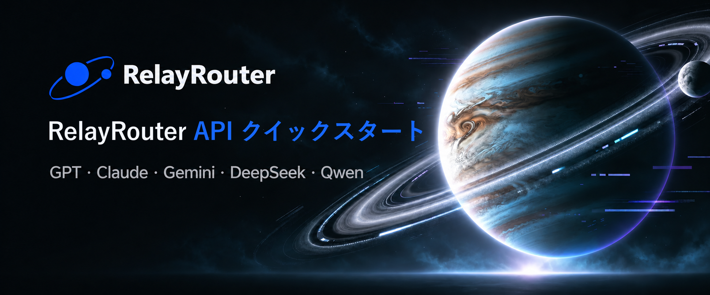
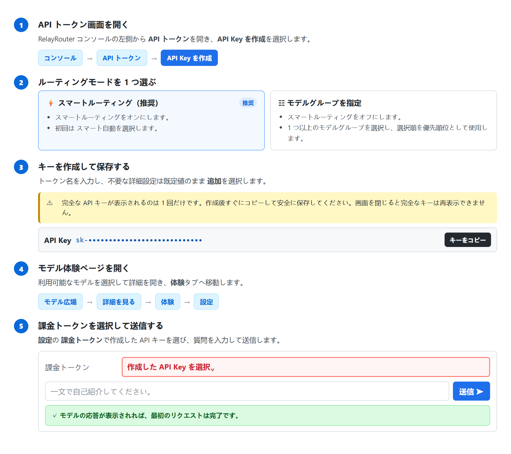
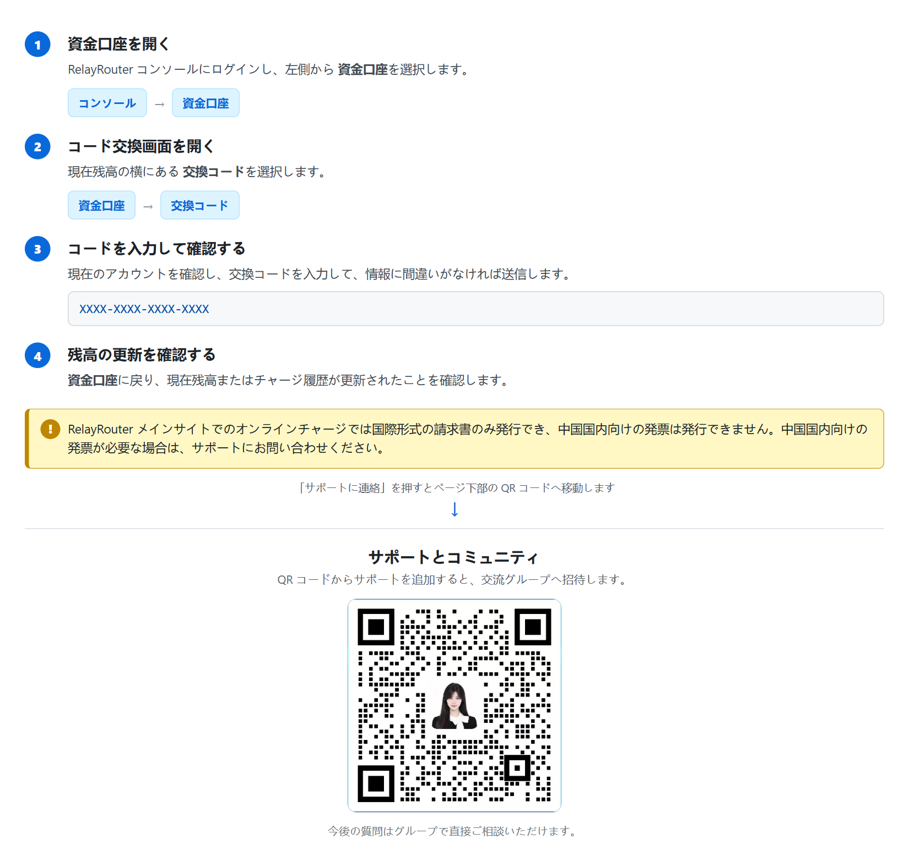
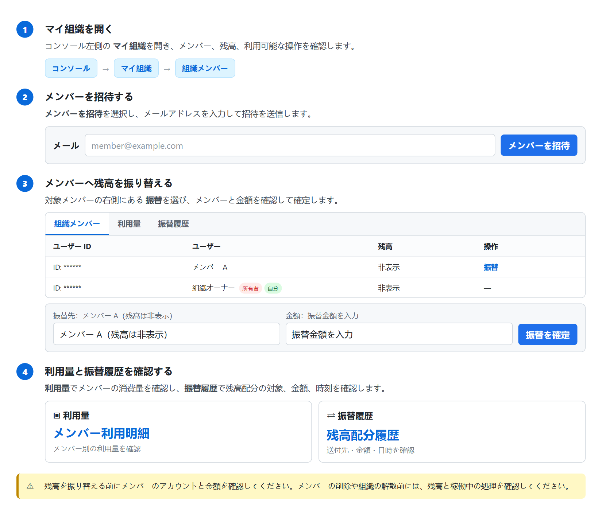
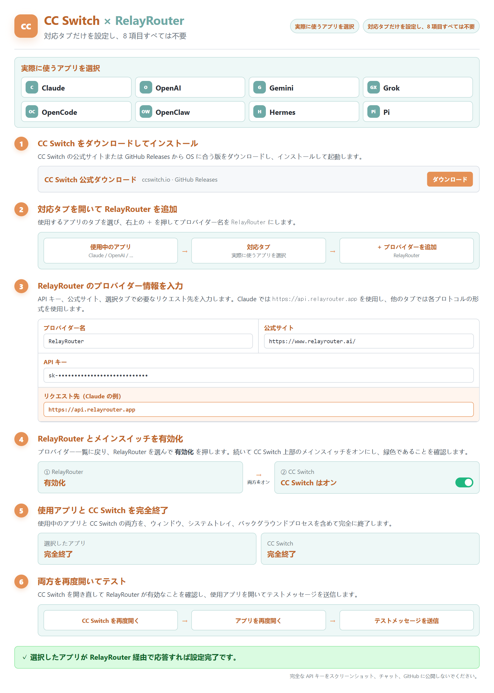
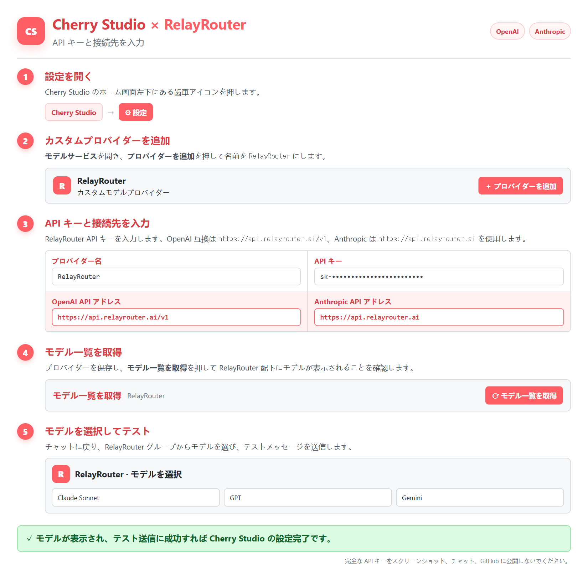
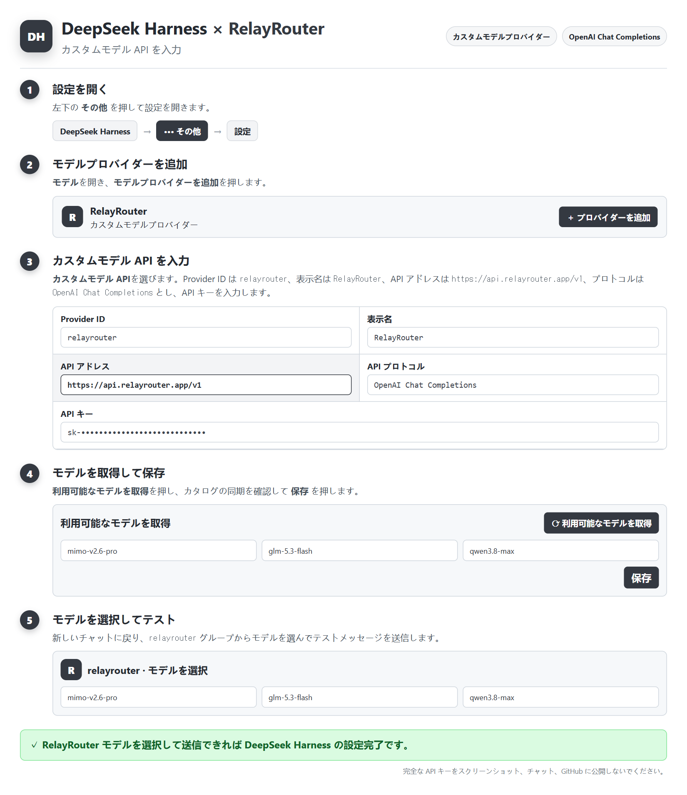

  <a lang="zh-CN" translate="no" href="./README.zh-CN.md">中文 (ZH)</a>
  &nbsp;|&nbsp;
  <a lang="en" translate="no" href="./README.md">English (EN)</a>
  &nbsp;|&nbsp;
  <a lang="ru" translate="no" href="./README.ru.md">Русский (RU)</a>
  &nbsp;|&nbsp;
  <a lang="ko" translate="no" href="./README.ko.md">한국어 (KO)</a>
  &nbsp;|&nbsp;
  <strong><a lang="ja" translate="no" href="./README.ja.md">日本語 (JA)</a></strong>
  &nbsp;|&nbsp;
  <a lang="es" translate="no" href="./README.es.md">Español (ES)</a>
  &nbsp;|&nbsp;
  <a lang="de" translate="no" href="./README.de.md">Deutsch (DE)</a>
  &nbsp;|&nbsp;
  <a lang="id" translate="no" href="./README.id.md">Bahasa Indonesia (ID)</a>

現在の言語：日本語（JA）。本文が別の言語で表示される場合は、github.com の自動翻訳を無効にしてください。

  

  
  &nbsp;&nbsp;
  

  
  
  
  

> 💡 <strong>ヒント：</strong>外部アカウントでログインできます。登録ページ下部の Sign in を選び、ログインページで GitHub、Google、または Linux DO のアイコンを選択してください。

<!-- relayrouter-announcements:start -->
> [!IMPORTANT]
> **最新のお知らせ · 自動同期**
>
> RelayRouter の最新のお知らせ 5 件：
>
> - `2026-11-27 09:50 (UTC+8)` — 通知：Cli-Gemini-1グループはリスク管理の理由により一時的に取り下げられました。復旧後に別途通知いたします。ご不便をおかけし、ご了承ください。
> - `2026-11-26 20:50 (UTC+8)` — 通知：kling-omni-image リソースが不足しているため、一時的にメンテナンスのために下架されました。今後リソースが十分に確保でき次第、再度通知いたします。
> - `2026-11-25 16:07 (UTC+8)` — 通知：【料金調整】北京時間2026/11/25 16:30 より、汎用ビデオインターフェースの呼び出し kling-3.0-turbo は秒単位での料金計算に変更され、Turbo 専用インターフェースと同じ価格になります。以前に少なく請求された料金は追加で請求されず、他のモデルやインターフェースには影響しません。具体的な価格はモデル広場に基づきます。
> - `2026-11-25 11:40 (UTC+8)` — 通知：Seedance-2グループ倍率が引き下げられました。詳細はモデル広場をご覧ください
> - `2026-11-24 17:43 (UTC+8)` — 通知：ACE MIDI 創作プランのリリース · ace-step-1.5-xl 価格引き下げ 1. ACE MIDI 創作プランのリリース: MIDI メロディのアップロードをサポートし、新しい音楽を生成します。著作権のある歌詞、アーティストのキーワード、カバー音声のマッチング、プロンプトのレビュータグなどでブロックされるシーンに適しています。モデル構成: ace/acemusic-v1.1（v1.1を使用する必要があります。旧バージョンはMIDIをサポートしていません） 2. ace-step-1.5-xl …
>
> [RelayRouter ですべてのお知らせを見る →](https://relayrouter.app/register?aff=xc9N)
<!-- relayrouter-announcements:end -->

## RelayRouter を選ぶ理由

RelayRouter は複数のモデルプロバイダーを単一の OpenAI 互換 API で利用できるようにし、重複する連携作業を減らします。

| 機能 | メリット |
| --- | --- |
| 統一 API 形式 | GPT、Claude、Gemini、DeepSeek、Qwen などの対応モデルを同じ形式で呼び出せます。 |
| 従量課金 | RelayRouter コンソールに記録された実際の利用量に基づく料金です。 |
| 一元管理 | API キー、モデル、利用量、請求を一か所で管理します。 |
| 組織の一元管理 | 組織の作成、メンバー招待、残高配分、メンバー利用量と振替履歴の確認ができます。 |
| 柔軟な接続先 | クライアントが別の `BASE_URL` 形式を求める場合、案内されたアドレスを順番に試せます。 |

## 何を行いたいですか？

目的を選ぶと、該当する手順へ直接移動できます。ページ全体を最初から読む必要はありません。

| 目的 | 目的 |
| --- | --- |
| **[最初の API 呼び出し →](#first-api-call)** 約 5 分 · API キー → BASE_URL → 最初のリクエスト | **[コード交換と残高確認 →](#redeem-code)** 約 2 分 · クレジットを交換して残高を確認 |
| **[チーム・組織管理 →](#organization-management)** 約 8 分 · 作成 → 招待 → 配分 → 利用量確認 | **[クライアント接続 →](#client-integration)** CC Switch、Cherry Studio、DeepSeek Harness |

## 基本チュートリアル

<strong>🔑 API キーの作成と最初のリクエスト</strong>

<!-- Source copy for the deterministic tutorial image:

#### 1. API トークン画面を開く

RelayRouter コンソールの左側から **API トークン**を開き、**API Key を作成**を選択します。

`コンソール` → `API トークン` → **API Key を作成**

#### 2. ルーティングモードを 1 つ選ぶ

| ⚡ スマートルーティング（推奨） | ☷ モデルグループを指定 |
| --- | --- |
| **スマートルーティング**をオンにします。 | **スマートルーティング**をオフにします。 |
| 初回は **スマート自動**を選択します。 | 1 つ以上のモデルグループを選択し、選択順を優先順位として使用します。 |

#### 3. キーを作成して保存する

トークン名を入力し、不要な詳細設定は既定値のまま **追加**を選択します。

> [!WARNING]
> 完全な API キーが表示されるのは 1 回だけです。作成後すぐにコピーして安全に保存してください。画面を閉じると完全なキーは再表示できません。

`API Key`　`sk-****************************`　**キーをコピー**

#### 4. モデル体験ページを開く

利用可能なモデルを選択して詳細を開き、**体験**タブへ移動します。

`モデル広場` → `詳細を見る` → `体験` → `設定`

#### 5. 課金トークンを選択して送信する

**設定**の **課金トークン**で作成した API キーを選び、質問を入力して送信します。

> [!TIP]
> モデルの応答が表示されれば、最初のリクエストは完了です。

-->

<strong>🎁 コード交換と残高確認</strong>

<strong><a href="#contact-support">サポートに連絡</a></strong>

<!-- Source copy for the deterministic tutorial image:

#### 1. 資金口座を開く

RelayRouter コンソールにログインし、左側から **資金口座**を選択します。

#### 2. コード交換画面を開く

現在残高の横にある **交換コード**を選択します。

#### 3. コードを入力して確認する

現在のアカウントを確認し、交換コードを入力して、情報に間違いがなければ送信します。

#### 4. 残高の更新を確認する

**資金口座**に戻り、現在残高またはチャージ履歴が更新されたことを確認します。

> [!IMPORTANT]
> RelayRouter メインサイトでのオンラインチャージでは国際形式の請求書のみ発行でき、中国国内向けの発票は発行できません。中国国内向けの発票が必要な場合は、[サポートにお問い合わせください](#contact-support)。

-->

<strong>👥 組織メンバーと利用量の管理</strong>

<!-- Source copy for the deterministic tutorial image:

#### 1. マイ組織を開く

コンソール左側の **マイ組織**を開き、メンバー、残高、利用可能な操作を確認します。

`コンソール` → `マイ組織` → `組織メンバー`

#### 2. メンバーを招待する

**メンバーを招待**を選択し、メールアドレスを入力して招待を送信します。

`member@example.com`　**メンバーを招待**

#### 3. メンバーへ残高を振り替える

対象メンバーの右側にある **振替**を選び、メンバーと金額を確認して確定します。

| ユーザー ID | ユーザー | 残高 | 操作 |
| --- | --- | --- | --- |
| `ID: ******` | メンバー A | 非表示 | **振替** |
| `ID: ******` | 組織オーナー | 非表示 | — |

`振替先：メンバー A（残高は非表示）`　`金額：振替金額を入力`　**振替を確定**

#### 4. 利用量と振替履歴を確認する

**利用量**でメンバーの消費量を確認し、**振替履歴**で残高配分の対象、金額、時刻を確認します。

> [!CAUTION]
> 残高を振り替える前にメンバーのアカウントと金額を確認してください。メンバーの削除や組織の解散前には、残高と稼働中の処理を確認してください。

-->

## クライアント接続チュートリアル

実際に使うアプリを選択してください。CC Switch では対象アプリのタブだけを設定し、Cherry Studio と DeepSeek Harness はそれぞれの手順を使用します。プロトコルごとに接続先形式が異なるため、[クイックリファレンス](#quick-reference)も確認してください。

<strong>CC Switch — Claude / OpenAI / Gemini / Grok / OpenCode / OpenClaw / Hermes / Pi</strong>

上記アプリのいずれかを RelayRouter で使う場合は、CC Switch の対応タブだけを設定します。8 項目すべてを設定する必要はありません。

#### 1. CC Switch をダウンロードしてインストール

CC Switch の公式サイトまたは GitHub Releases から OS に合う版をダウンロードし、インストールして起動します。

#### 2. 対応タブを開いて RelayRouter を追加

使用するアプリのタブを選び、右上の `＋` を押してプロバイダー名を `RelayRouter` にします。

#### 3. RelayRouter のプロバイダー情報を入力

API キー、公式サイト、選択タブで必要なリクエスト先を入力します。Claude では `https://api.relayrouter.app` を使用し、他のタブでは各プロトコルの形式を使用します。

#### 4. RelayRouter とメインスイッチを有効化

プロバイダー一覧に戻り、RelayRouter を選んで **有効化** を押します。続いて CC Switch 上部のメインスイッチをオンにし、緑色であることを確認します。

#### 5. 使用アプリと CC Switch を完全終了

使用中のアプリと CC Switch の両方を、ウィンドウ、システムトレイ、バックグラウンドプロセスを含めて完全に終了します。

#### 6. 両方を再度開いてテスト

CC Switch を開き直して RelayRouter が有効なことを確認し、使用アプリを開いてテストメッセージを送信します。

<strong>Cherry Studio</strong>

#### 1. 設定を開く

Cherry Studio のホーム画面左下にある歯車アイコンを押します。

#### 2. カスタムプロバイダーを追加

**モデルサービス**を開き、**プロバイダーを追加**を押して名前を `RelayRouter` にします。

#### 3. API キーと接続先を入力

RelayRouter API キーを入力します。OpenAI 互換は `https://api.relayrouter.ai/v1`、Anthropic は `https://api.relayrouter.ai` を使用します。

#### 4. モデル一覧を取得

プロバイダーを保存し、**モデル一覧を取得**を押して RelayRouter 配下にモデルが表示されることを確認します。

#### 5. モデルを選択してテスト

チャットに戻り、RelayRouter グループからモデルを選び、テストメッセージを送信します。

<strong>DeepSeek Harness</strong>

#### 1. 設定を開く

左下の **その他** を押して設定を開きます。

#### 2. モデルプロバイダーを追加

**モデル**を開き、**モデルプロバイダーを追加**を押します。

#### 3. カスタムモデル API を入力

**カスタムモデル API**を選びます。Provider ID は `relayrouter`、表示名は `RelayRouter`、API アドレスは `https://api.relayrouter.app/v1`、プロトコルは `OpenAI Chat Completions` とし、API キーを入力します。

#### 4. モデルを取得して保存

**利用可能なモデルを取得**を押し、カタログの同期を確認して **保存** を押します。

#### 5. モデルを選択してテスト

新しいチャットに戻り、`relayrouter` グループからモデルを選んでテストメッセージを送信します。

## クイックリファレンス

クライアントによって必要な `BASE_URL` 形式が異なる場合があります。次の順に試してください。

1. `https://api.relayrouter.app`
2. `https://api.relayrouter.app/v1`
3. `https://api.relayrouter.app/v1/chat/completions`

このリポジトリの SDK サンプルは、既定で `https://api.relayrouter.app/v1` を使用します。クライアントがベース URL ではなくチャット補完の完全なアドレスを要求する場合は、3 番目を使用してください。

## 実行可能なサンプル

| 言語 | ファイル | 実行コマンド |
| --- | --- | --- |
| Python | [`examples/python/chat.py`](./examples/python/chat.py) | `python examples/python/chat.py` |
| JavaScript | [`examples/javascript/chat.mjs`](./examples/javascript/chat.mjs) | `node examples/javascript/chat.mjs` |
| PowerShell | [`examples/powershell/request.ps1`](./examples/powershell/request.ps1) | `pwsh examples/powershell/request.ps1` |

## ドキュメントとセキュリティ

- [詳細クイックスタート](./docs/quickstart.md)
- [よくある質問](./docs/faq.md)
- [トラブルシューティング](./docs/troubleshooting.md)
- [セキュリティポリシー](./SECURITY.md)

API キーを Git にコミットしないでください。`.env` またはデプロイ先のシークレット管理に保存してください。

<strong>1 つの API キーで、より多くのモデルを、より少ない連携作業で。</strong>

  

QR コードを読み取ってサポート担当を追加してください。ユーザーグループへご招待します。今後のご質問はグループ内で直接お問い合わせいただけます。

