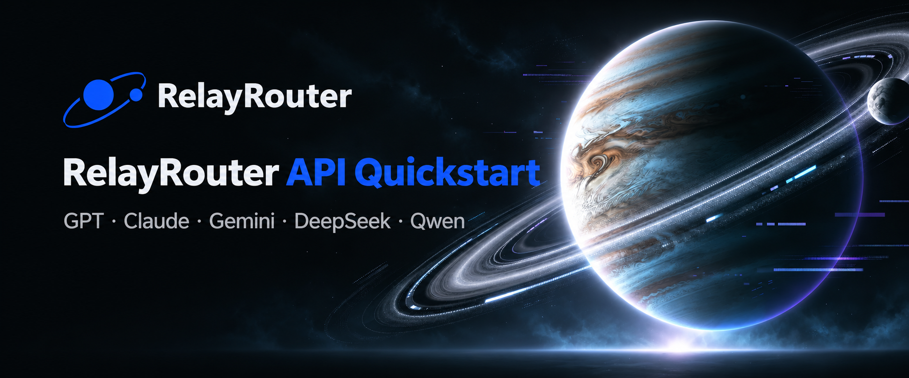

<p align="center">
  <a href="./README.zh-CN.md">中文</a> |
  <a href="./README.md">English</a> |
  <a href="./README.ru.md">Русский</a> |
  <a href="./README.ko.md">한국어</a> |
  <strong>日本語</strong> |
  <a href="./README.es.md">Español</a> |
  <a href="./README.de.md">Deutsch</a> |
  <a href="./README.id.md">Bahasa Indonesia</a>
</p>

<p align="center"></p>

<p align="center">
  <a href="https://relayrouter.app/register?aff=xc9N"></a>
  &nbsp;&nbsp;
  <a href="https://relayrouter.ai/register?aff=xc9N"></a>
</p>

> [!TIP]
> **外部アカウントでログインできます。** 登録ページ下部の **Sign in** を選び、ログインページで **GitHub**、**Google**、または **Linux DO** のアイコンを選択してください。

> [!NOTE]
> 上の登録リンクには紹介コード `aff=xc9N` が含まれています。登録がリポジトリ所有者の実績に反映される場合がありますが、サービス料金は変わりません。

## RelayRouter を選ぶ理由

RelayRouter は複数のモデルプロバイダーを単一の OpenAI 互換 API で利用できるようにし、重複する連携作業を減らします。

| 機能 | メリット |
| --- | --- |
| 統一 API 形式 | GPT、Claude、Gemini、DeepSeek、Qwen などの対応モデルを同じ形式で呼び出せる |
| 従量課金 | RelayRouter コンソールに記録された実際の利用量に基づく料金 |
| 一元管理 | API キー、モデル、利用量、請求を一か所で管理 |
| 地域別アクセス | 所在地に合う登録サイトと API アドレスを選択 |

## 5 分で始める

### 1. 登録して API キーを作成

| 地域 | 登録 | 一般的な API Base URL |
| --- | --- | --- |
| 中国本土 | [relayrouter.app](https://relayrouter.app/register?aff=xc9N) | `https://api.relayrouter.app/v1` |
| グローバル | [relayrouter.ai](https://relayrouter.ai/register?aff=xc9N) | `https://api.relayrouter.ai/v1` |

登録後、RelayRouter コンソールで API キーを作成します。コンソールに別のアドレスが表示される場合は、その値を使ってください。

### 2. プロジェクトを設定

```bash
cp .env.example .env
```

```dotenv
RELAYROUTER_API_KEY=your_api_key_here
RELAYROUTER_BASE_URL=https://api.relayrouter.ai/v1
RELAYROUTER_MODEL=your_model_name
```

中国本土向けエンドポイントは `https://api.relayrouter.app/v1` です。

### 3. 実行

```bash
python -m pip install -r requirements.txt
python examples/python/chat.py
```

## 実行可能なサンプル

| 言語 | ファイル | コマンド |
| --- | --- | --- |
| Python | [`examples/python/chat.py`](./examples/python/chat.py) | `python examples/python/chat.py` |
| JavaScript | [`examples/javascript/chat.mjs`](./examples/javascript/chat.mjs) | `node examples/javascript/chat.mjs` |
| PowerShell | [`examples/powershell/request.ps1`](./examples/powershell/request.ps1) | `pwsh examples/powershell/request.ps1` |

## ドキュメントとセキュリティ

- [詳細クイックスタート](./docs/quickstart.md)
- [よくある質問](./docs/faq.md)
- [トラブルシューティング](./docs/troubleshooting.md)
- [セキュリティポリシー](./SECURITY.md)

API キーを Git にコミットしないでください。`.env` またはデプロイ先のシークレット管理に保存してください。

<p align="center"><strong>1 つの API キーで、より多くのモデルを、より少ない連携作業で。</strong></p>
