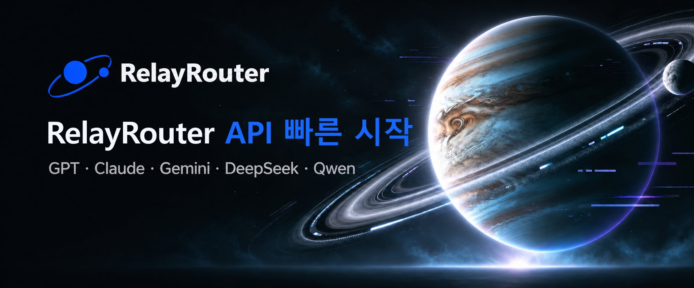

  <a lang="zh-CN" translate="no" href="./README.zh-CN.md">中文 (ZH)</a>
  &nbsp;|&nbsp;
  <a lang="en" translate="no" href="./README.md">English (EN)</a>
  &nbsp;|&nbsp;
  <a lang="ru" translate="no" href="./README.ru.md">Русский (RU)</a>
  &nbsp;|&nbsp;
  <strong><a lang="ko" translate="no" href="./README.ko.md">한국어 (KO)</a></strong>
  &nbsp;|&nbsp;
  <a lang="ja" translate="no" href="./README.ja.md">日本語 (JA)</a>
  &nbsp;|&nbsp;
  <a lang="es" translate="no" href="./README.es.md">Español (ES)</a>
  &nbsp;|&nbsp;
  <a lang="de" translate="no" href="./README.de.md">Deutsch (DE)</a>
  &nbsp;|&nbsp;
  <a lang="id" translate="no" href="./README.id.md">Bahasa Indonesia (ID)</a>

현재 언어: 한국어(KO). 본문이 다른 언어로 보이면 github.com 자동 번역을 꺼 주세요.

  

  
  &nbsp;&nbsp;
  

  
  
  
  

> 💡 <strong>도움말:</strong> 타사 계정 로그인을 지원합니다. 가입 페이지 하단의 Sign in을 누른 뒤 로그인 페이지에서 GitHub, Google 또는 Linux DO 아이콘을 선택하세요.

<!-- relayrouter-announcements:start -->
> [!IMPORTANT]
> **최신 공지 · 자동 동기화**
>
> RelayRouter 최신 공지 5개:
>
> - `2026-11-18 17:08 (UTC+8)` — 모델 출시: doubao-seedream-5-5-261028
> - `2026-11-18 16:33 (UTC+8)` — 모델 배포: gpt-6.2-astra, gpt-6.2-sol
> - `2026-11-18 14:58 (UTC+8)` — 알림: gemini-4-carbon 모델의 anti 리소스가 부족하여 해당 모델의 anti 리소스 그룹이 일시적으로 중단되었습니다.
> - `2026-11-17 22:46 (UTC+8)` — 알림: AWS-Gpt-1 그룹 자원이 부족하여 해당 자원 그룹이 일시적으로 하차되었습니다.
> - `2026-11-16 21:24 (UTC+8)` — 모델 배포: hy4-flash
>
> [RelayRouter에서 모든 공지 보기 →](https://relayrouter.app/register?aff=xc9N)
<!-- relayrouter-announcements:end -->

## RelayRouter를 선택하는 이유

RelayRouter는 여러 모델 공급자를 하나의 OpenAI 호환 API로 연결해 반복적인 연동 작업을 줄여 줍니다.

| 기능 | 이점 |
| --- | --- |
| 하나의 API 형식 | 익숙한 방식으로 GPT, Claude, Gemini, DeepSeek, Qwen 등 지원 모델을 호출합니다. |
| 사용량 기반 요금 | RelayRouter 콘솔에 기록된 실제 사용량을 기준으로 결제합니다. |
| 통합 관리 | API 키, 모델 접근, 사용량, 결제를 한곳에서 관리합니다. |
| 조직 통합 관리 | 조직을 만들고 구성원을 초대하며 잔액을 배분하고 구성원 사용량과 이체 기록을 확인합니다. |
| 유연한 연결 주소 | 클라이언트가 다른 `BASE_URL` 형식을 요구하면 안내된 주소를 순서대로 시도할 수 있습니다. |

## 무엇을 하시겠습니까?

목표를 선택해 해당 튜토리얼로 바로 이동하세요. 문서 전체를 처음부터 읽을 필요가 없습니다.

| 목표 | 목표 |
| --- | --- |
| **[첫 API 호출 실행 →](#first-api-call)** 약 5분 · API 키 → BASE_URL → 첫 요청 | **[코드 교환 및 잔액 확인 →](#redeem-code)** 약 2분 · 크레딧 교환 후 계정 잔액 확인 |
| **[팀 또는 조직 관리 →](#organization-management)** 약 8분 · 생성 → 초대 → 배분 → 사용량 확인 | **[클라이언트 연결 →](#client-integration)** ChatGPT, Claude, Cherry Studio, Gemini, DeepSeek Harness |

## 기본 튜토리얼

<strong>🔑 API 키 생성 및 첫 요청</strong>

#### 1. API 토큰 페이지 열기

RelayRouter 콘솔의 왼쪽 메뉴에서 **API 토큰**을 열고 **API Key 생성**을 선택합니다.

`콘솔` → `API 토큰` → **API Key 생성**

#### 2. 라우팅 모드 하나 선택하기

| ⚡ 스마트 라우팅 (권장) | ☷ 모델 그룹 직접 선택 |
| --- | --- |
| **스마트 라우팅**을 켭니다. | **스마트 라우팅**을 끕니다. |
| 처음에는 **스마트 자동**을 선택하면 됩니다. | 하나 이상의 모델 그룹을 선택하며, 선택 순서가 우선순위가 됩니다. |

#### 3. 키 생성 및 저장

토큰 이름을 입력하고 필요하지 않은 고급 옵션은 기본값으로 둔 다음 **추가**를 선택합니다.

> [!WARNING]
> 전체 API 키는 한 번만 표시됩니다. 생성 즉시 복사하여 안전하게 보관하세요. 창을 닫으면 전체 키를 다시 볼 수 없습니다.

`API Key`　`sk-****************************`　**키 복사**

#### 4. 모델 체험 페이지 열기

사용 가능한 모델을 선택하고 상세 페이지를 연 뒤 **체험** 탭으로 이동합니다.

`모델 광장` → `상세 보기` → `체험` → `설정`

#### 5. 결제 토큰 선택 후 전송

**설정**의 **결제 토큰**에서 방금 생성한 API 키를 선택하고 질문을 입력한 뒤 전송합니다.

> [!TIP]
> 모델 응답이 표시되면 첫 요청이 완료된 것입니다.

<strong>🎁 코드 교환 및 잔액 확인</strong>

#### 1. 자금 계정 열기

RelayRouter 콘솔에 로그인하고 왼쪽 메뉴에서 **자금 계정**을 선택합니다.

#### 2. 교환 코드 입력 창 열기

현재 잔액 옆의 **교환 코드**를 선택합니다.

#### 3. 코드 입력 및 확인

현재 계정을 확인하고 교환 코드를 입력한 뒤 정보가 맞으면 제출합니다.

#### 4. 잔액 업데이트 확인

**자금 계정**으로 돌아가 현재 잔액 또는 충전 기록이 갱신되었는지 확인합니다.

> [!IMPORTANT]
> RelayRouter 메인 사이트의 온라인 충전에는 국제 형식 인보이스만 발급되며 중국 국내용 세금계산서는 제공되지 않습니다. 중국 국내용 세금계산서가 필요하면 [고객 지원에 문의하세요](#contact-support).

<strong>👥 조직 구성원 및 사용량 관리</strong>

#### 1. 내 조직 열기

콘솔 왼쪽 메뉴에서 **내 조직**을 열어 구성원, 잔액 및 사용 가능한 작업을 확인합니다.

`콘솔` → `내 조직` → `조직 구성원`

#### 2. 구성원 초대

**구성원 초대**를 선택하고 구성원의 이메일 주소를 입력한 뒤 초대를 보냅니다.

`member@example.com`　**구성원 초대**

#### 3. 구성원에게 잔액 이체

대상 구성원 옆의 **이체**를 선택하고 구성원과 금액을 확인한 뒤 확정합니다.

| 사용자 ID | 사용자 | 잔액 | 작업 |
| --- | --- | --- | --- |
| `ID: ******` | 구성원 A | 숨김 | **이체** |
| `ID: ******` | 조직 소유자 | 숨김 | — |

`이체 대상: 구성원 A (잔액 숨김)`　`금액: 이체 금액 입력`　**이체 확인**

#### 4. 사용량 및 이체 기록 확인

**사용량**에서 구성원 소비량을 확인하고 **이체 기록**에서 잔액 배분 대상, 금액 및 시간을 확인합니다.

> [!CAUTION]
> 잔액을 이체하기 전에 구성원 계정과 금액을 확인하세요. 구성원을 삭제하거나 조직을 해산하기 전에는 남은 잔액과 사용 중인 작업을 확인하세요.

## 클라이언트 연동 튜토리얼

클라이언트에 따라 기본 URL 또는 전체 chat-completions 주소를 요구할 수 있습니다. 먼저 `https://api.relayrouter.app/v1`을 사용하고 형식이 다르면 [빠른 참조](#quick-reference)를 확인하세요.

<strong>ChatGPT 바로가기</strong>

바로가기의 공급자 설정에서 사용자 지정 또는 OpenAI 호환 공급자를 선택하고 RelayRouter API 키와 주소를 입력한 뒤 지원 모델을 선택합니다.

<strong>Claude 바로가기</strong>

바로가기의 공급자 설정에서 사용자 지정 또는 OpenAI 호환 공급자를 선택하고 RelayRouter API 키와 주소를 입력한 뒤 지원 모델을 선택합니다.

<strong>Cherry Studio</strong>

**API 엔드포인트:** `https://api.relayrouter.app/v1`

1. Cherry Studio에 사용자 지정 OpenAI 호환 공급자를 추가합니다.
2. `BASE_URL`과 RelayRouter API 키를 입력합니다.
3. 지원 모델을 추가하고 설정을 저장한 뒤 테스트 메시지를 보냅니다.

<strong>Gemini</strong>

RelayRouter로 Gemini 모델을 사용하려면 사용자 지정 OpenAI 호환 공급자에 RelayRouter 주소와 키를 입력하고 지원되는 Gemini 모델 식별자를 선택합니다.

<strong>DeepSeek Harness</strong>

Harness 공급자를 OpenAI 호환 엔드포인트로 설정하고 RelayRouter `BASE_URL`과 API 키를 입력한 뒤 지원 DeepSeek 모델로 연결을 테스트합니다.

## 빠른 참조

클라이언트마다 필요한 `BASE_URL` 형식이 다를 수 있습니다. 다음 주소를 순서대로 시도하세요.

1. `https://api.relayrouter.app`
2. `https://api.relayrouter.app/v1`
3. `https://api.relayrouter.app/v1/chat/completions`

이 저장소의 SDK 예제는 기본적으로 `https://api.relayrouter.app/v1`을 사용합니다. 클라이언트가 기본 주소가 아니라 전체 채팅 완성 주소를 요구하면 세 번째 주소를 사용하세요.

## 실행 가능한 예제

| 언어 | 파일 | 실행 명령 |
| --- | --- | --- |
| Python | [`examples/python/chat.py`](./examples/python/chat.py) | `python examples/python/chat.py` |
| JavaScript | [`examples/javascript/chat.mjs`](./examples/javascript/chat.mjs) | `node examples/javascript/chat.mjs` |
| PowerShell | [`examples/powershell/request.ps1`](./examples/powershell/request.ps1) | `pwsh examples/powershell/request.ps1` |

## 문서 및 보안

- [상세 빠른 시작](./docs/quickstart.md)
- [자주 묻는 질문](./docs/faq.md)
- [문제 해결](./docs/troubleshooting.md)
- [보안 정책](./SECURITY.md)

API 키를 Git에 커밋하지 마세요. `.env` 또는 배포 플랫폼의 비밀 관리자에 보관하세요.

<strong>하나의 API 키로 더 많은 모델을 더 간단하게.</strong>

  

QR 코드를 스캔해 고객 지원 담당자를 추가하세요. 사용자 그룹으로 초대해 드리며, 이후 궁금한 점은 그룹에서 바로 문의할 수 있습니다.

