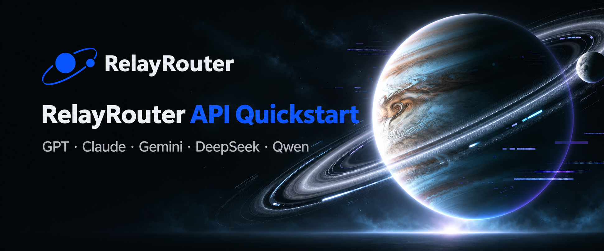
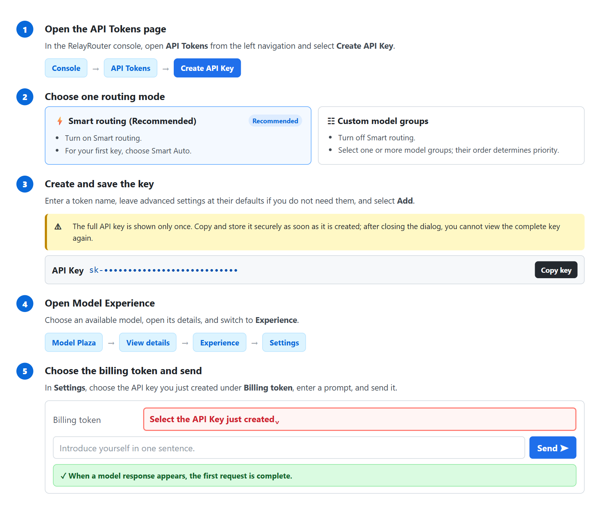
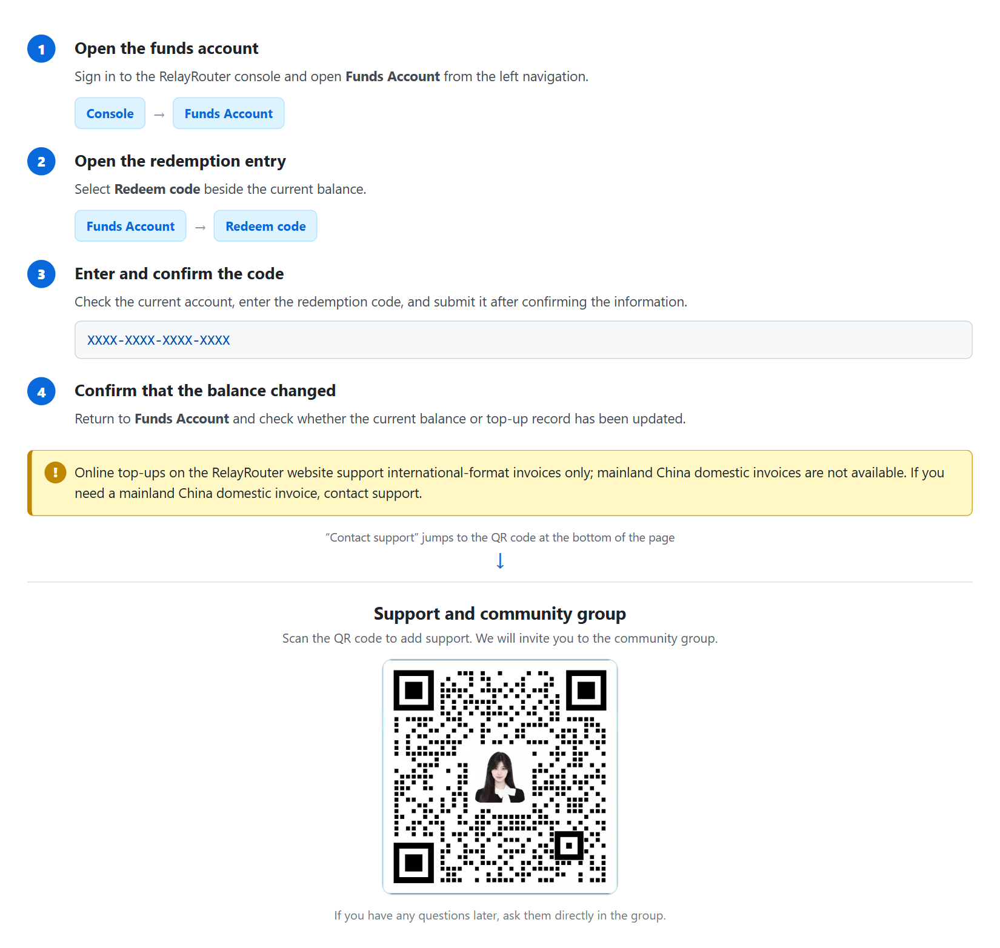
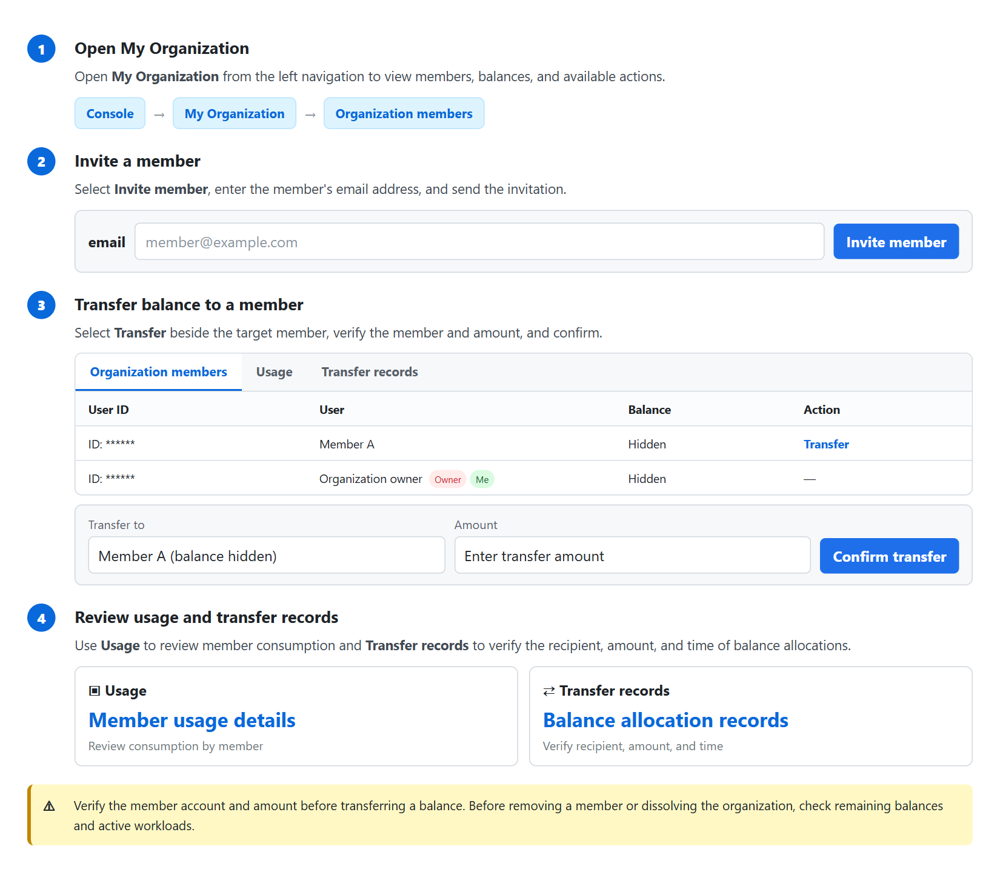
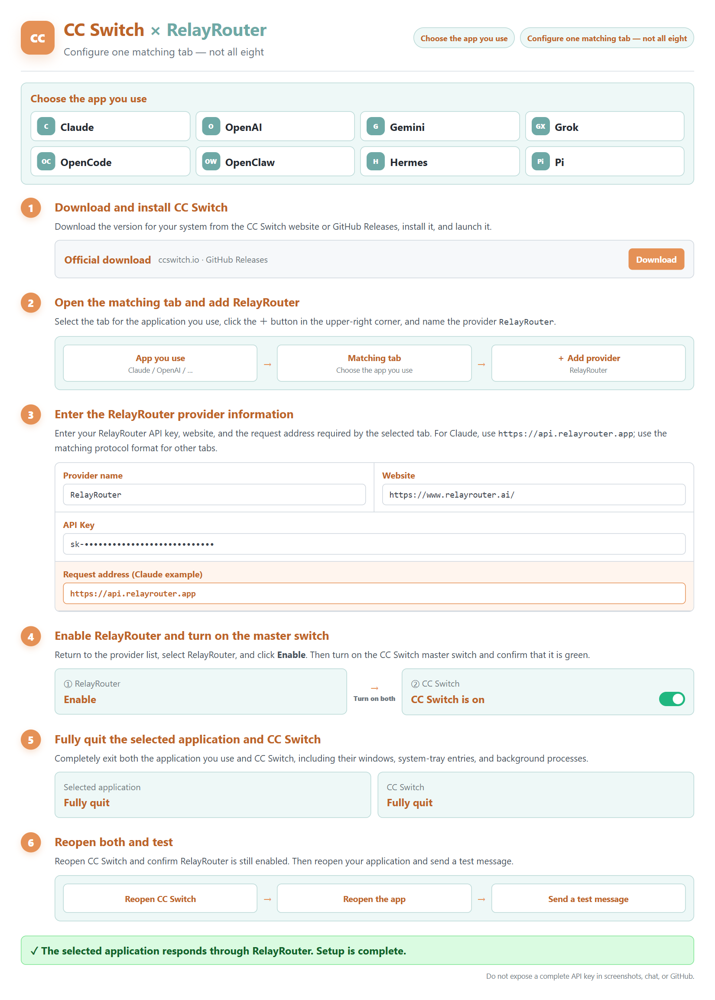
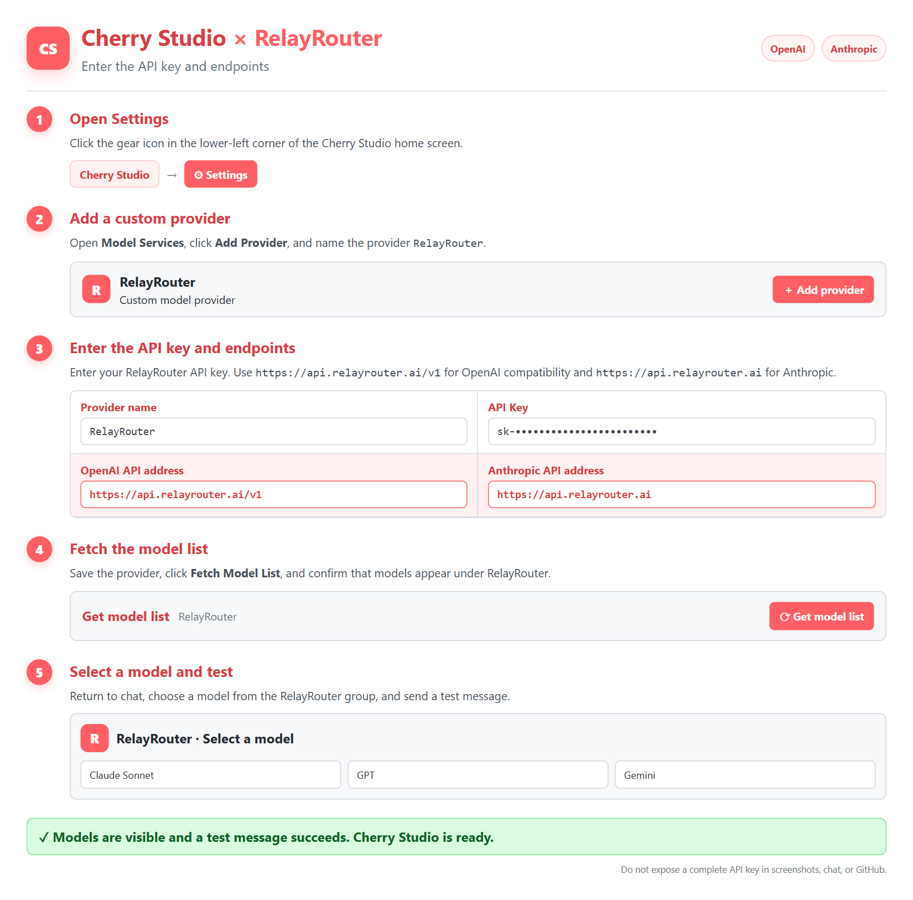
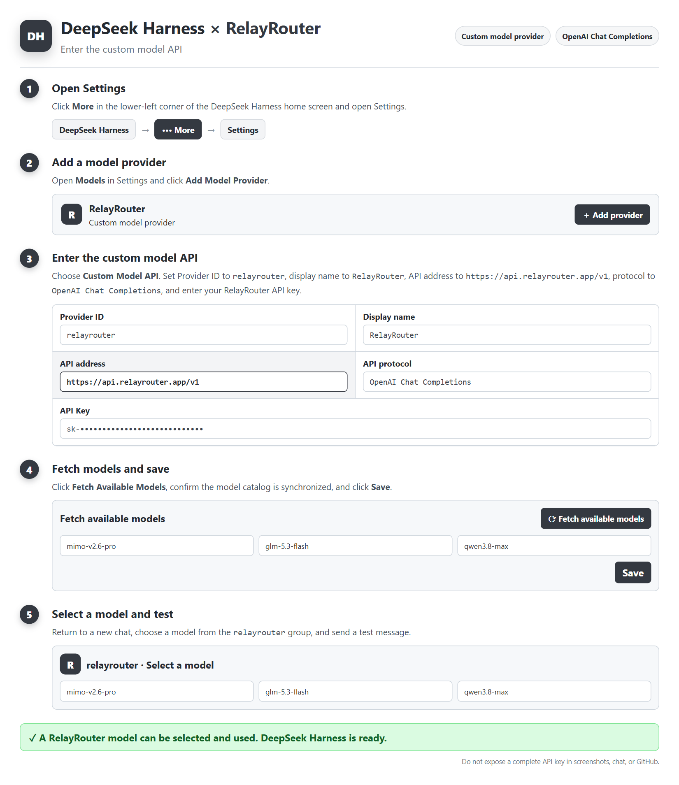

  <a lang="zh-CN" translate="no" href="./README.zh-CN.md">中文 (ZH)</a>
  &nbsp;|&nbsp;
  <strong><a lang="en" translate="no" href="./README.md">English (EN)</a></strong>
  &nbsp;|&nbsp;
  <a lang="ru" translate="no" href="./README.ru.md">Русский (RU)</a>
  &nbsp;|&nbsp;
  <a lang="ko" translate="no" href="./README.ko.md">한국어 (KO)</a>
  &nbsp;|&nbsp;
  <a lang="ja" translate="no" href="./README.ja.md">日本語 (JA)</a>
  &nbsp;|&nbsp;
  <a lang="es" translate="no" href="./README.es.md">Español (ES)</a>
  &nbsp;|&nbsp;
  <a lang="de" translate="no" href="./README.de.md">Deutsch (DE)</a>
  &nbsp;|&nbsp;
  <a lang="id" translate="no" href="./README.id.md">Bahasa Indonesia (ID)</a>

Current language: English (EN). If this page appears in another language, disable automatic translation for github.com.

  

  
  &nbsp;&nbsp;
  

  
  
  
  

> 💡 <strong>Tip:</strong> Third-party sign-in is supported. Open a registration page, select Sign in at the bottom, then choose the GitHub, Google, or Linux DO icon.

<!-- relayrouter-announcements:start -->
> [!IMPORTANT]
> **Announcement updates · Auto-synced**
>
> The latest 5 RelayRouter announcements:
>
> - `2026-11-25 16:07 (UTC+8)` — Notification: [Billing Adjustment] Starting from November 25, 2026, 16:30 Beijing time, the general video API call kling-3.0-turbo will be billed per second, at the same rate as the Turbo dedicated interface. Fees that were previously undercharged will not be…
> - `2026-11-25 11:40 (UTC+8)` — Notification: The group multiplier for Seedance-2 has been reduced. Please see the model square for details.
> - `2026-11-24 17:43 (UTC+8)` — Notification: ACE MIDI Creation Plan Launched · ace-step-1.5-xl Price Reduction 1. ACE MIDI Creation Plan Launched: Supports uploading MIDI melodies to generate new music, applicable for scenarios where copyright lyrics, artist keywords, cover audio matching,…
> - `2026-11-23 17:25 (UTC+8)` — Notice: Starting from November 23, 2026, 17:00 Beijing time, once a request for grouped drawing from OpenAI and Azure sources is made, if you actively disconnect or cancel the connection before the drawing is completed, you will still be charged for one call.…
> - `2026-11-23 17:01 (UTC+8)` — Model Launch: minimax-h3-z
>
> [Open RelayRouter to view all announcements →](https://relayrouter.app/register?aff=xc9N)
<!-- relayrouter-announcements:end -->

## Why RelayRouter?

RelayRouter provides one OpenAI-compatible API for multiple model providers, so you can spend less time integrating separate SDKs and more time building your product.

| Capability | What it gives you |
| --- | --- |
| One API format | Call GPT, Claude, Gemini, DeepSeek, Qwen, and other supported models through a familiar interface. |
| Usage-based billing | Pay for the usage recorded in your RelayRouter console. |
| Centralized management | Keep API keys, model access, usage, and billing in one place. |
| Organization management | Create an organization, invite members, allocate balances, and review member usage and transfer records. |
| Flexible connection URLs | Try the documented RelayRouter URLs in order when a client expects a different `BASE_URL` format. |

## What do you want to accomplish?

Choose a goal and jump directly to its tutorial. You do not need to read the whole page from top to bottom.

| Goal | Goal |
| --- | --- |
| **[Make your first API call →](#first-api-call)** About 5 minutes · API key → BASE_URL → first request | **[Redeem a code and check the balance →](#redeem-code)** About 2 minutes · Redeem credit and verify the account balance |
| **[Manage a team or organization →](#organization-management)** About 8 minutes · Create → invite → allocate → review usage | **[Connect a client →](#client-integration)** CC Switch, Cherry Studio, and DeepSeek Harness |

## Basic tutorials

<strong>🔑 Create an API key and make the first request</strong>

<!-- Source copy for the deterministic tutorial image:

#### 1. Open the API Tokens page

In the RelayRouter console, open **API Tokens** from the left navigation and select **Create API Key**.

`Console` → `API Tokens` → **Create API Key**

#### 2. Choose one routing mode

| ⚡ Smart routing (Recommended) | ☷ Custom model groups |
| --- | --- |
| Turn on **Smart routing**. | Turn off **Smart routing**. |
| For your first key, choose **Smart Auto**. | Select one or more model groups; their order determines priority. |

#### 3. Create and save the key

Enter a token name, leave advanced settings at their defaults if you do not need them, and select **Add**.

> [!WARNING]
> The full API key is shown only once. Copy and store it securely as soon as it is created; after closing the dialog, you cannot view the complete key again.

`API Key`　`sk-****************************`　**Copy key**

#### 4. Open Model Experience

Choose an available model, open its details, and switch to **Experience**.

`Model Plaza` → `View details` → `Experience` → `Settings`

#### 5. Choose the billing token and send

In **Settings**, choose the API key you just created under **Billing token**, enter a prompt, and send it.

> [!TIP]
> When a model response appears, the first request is complete.

-->

<strong>🎁 Redeem a code and check the balance</strong>

<strong><a href="#contact-support">Contact support</a></strong>

<!-- Source copy for the deterministic tutorial image:

#### 1. Open the funds account

Sign in to the RelayRouter console and open **Funds Account** from the left navigation.

#### 2. Open the redemption entry

Select **Redeem code** beside the current balance.

#### 3. Enter and confirm the code

Check the current account, enter the redemption code, and submit it after confirming the information.

#### 4. Confirm that the balance changed

Return to **Funds Account** and check whether the current balance or top-up record has been updated.

> [!IMPORTANT]
> Online top-ups on the RelayRouter website support international-format invoices only; mainland China domestic invoices are not available. If you need a mainland China domestic invoice, [contact support](#contact-support).

-->

<strong>👥 Manage organization members and usage</strong>

<!-- Source copy for the deterministic tutorial image:

#### 1. Open My Organization

Open **My Organization** from the left navigation to view members, balances, and available actions.

`Console` → `My Organization` → `Organization members`

#### 2. Invite a member

Select **Invite member**, enter the member's email address, and send the invitation.

`member@example.com`　**Invite member**

#### 3. Transfer balance to a member

Select **Transfer** beside the target member, verify the member and amount, and confirm.

| User ID | User | Balance | Action |
| --- | --- | --- | --- |
| `ID: ******` | Member A | Hidden | **Transfer** |
| `ID: ******` | Organization owner | Hidden | — |

`Transfer to: Member A (balance hidden)`　`Amount: Enter transfer amount`　**Confirm transfer**

#### 4. Review usage and transfer records

Use **Usage** to review member consumption and **Transfer records** to verify the recipient, amount, and time of balance allocations.

> [!CAUTION]
> Verify the member account and amount before transferring a balance. Before removing a member or dissolving the organization, check remaining balances and active workloads.

-->

## Client integration tutorials

Choose the application you actually use. With CC Switch, configure only the matching application tab; Cherry Studio and DeepSeek Harness use their own setup flows. Endpoint formats vary by protocol, so also check the [quick reference](#quick-reference).

<strong>CC Switch — Claude / OpenAI / Gemini / Grok / OpenCode / OpenClaw / Hermes / Pi</strong>

If you use any one of the applications above with RelayRouter, configure only its matching tab in CC Switch. You do not need to configure all eight.

#### 1. Download and install CC Switch

Download the version for your system from the CC Switch website or GitHub Releases, install it, and launch it.

#### 2. Open the matching tab and add RelayRouter

Select the tab for the application you use, click the `＋` button in the upper-right corner, and name the provider `RelayRouter`.

#### 3. Enter the RelayRouter provider information

Enter your RelayRouter API key, website, and the request address required by the selected tab. For Claude, use `https://api.relayrouter.app`; use the matching protocol format for other tabs.

#### 4. Enable RelayRouter and turn on the master switch

Return to the provider list, select RelayRouter, and click **Enable**. Then turn on the CC Switch master switch and confirm that it is green.

#### 5. Fully quit the selected application and CC Switch

Completely exit both the application you use and CC Switch, including their windows, system-tray entries, and background processes.

#### 6. Reopen both and test

Reopen CC Switch and confirm RelayRouter is still enabled. Then reopen your application and send a test message.

<strong>Cherry Studio</strong>

#### 1. Open Settings

Click the gear icon in the lower-left corner of the Cherry Studio home screen.

#### 2. Add a custom provider

Open **Model Services**, click **Add Provider**, and name the provider `RelayRouter`.

#### 3. Enter the API key and endpoints

Enter your RelayRouter API key. Use `https://api.relayrouter.ai/v1` for OpenAI compatibility and `https://api.relayrouter.ai` for Anthropic.

#### 4. Fetch the model list

Save the provider, click **Fetch Model List**, and confirm that models appear under RelayRouter.

#### 5. Select a model and test

Return to chat, choose a model from the RelayRouter group, and send a test message.

<strong>DeepSeek Harness</strong>

#### 1. Open Settings

Click **More** in the lower-left corner of the DeepSeek Harness home screen and open Settings.

#### 2. Add a model provider

Open **Models** in Settings and click **Add Model Provider**.

#### 3. Enter the custom model API

Choose **Custom Model API**. Set Provider ID to `relayrouter`, display name to `RelayRouter`, API address to `https://api.relayrouter.app/v1`, protocol to `OpenAI Chat Completions`, and enter your RelayRouter API key.

#### 4. Fetch models and save

Click **Fetch Available Models**, confirm the model catalog is synchronized, and click **Save**.

#### 5. Select a model and test

Return to a new chat, choose a model from the `relayrouter` group, and send a test message.

## Quick reference

Different clients may require different `BASE_URL` formats. Try these addresses in order:

1. `https://api.relayrouter.app`
2. `https://api.relayrouter.app/v1`
3. `https://api.relayrouter.app/v1/chat/completions`

The SDK examples in this repository use `https://api.relayrouter.app/v1` by default. If a client asks for a complete chat-completions endpoint instead of a base URL, use the third address.

## Ready-to-run examples

| Language | File | Run command |
| --- | --- | --- |
| Python | [`examples/python/chat.py`](./examples/python/chat.py) | `python examples/python/chat.py` |
| JavaScript | [`examples/javascript/chat.mjs`](./examples/javascript/chat.mjs) | `node examples/javascript/chat.mjs` |
| PowerShell | [`examples/powershell/request.ps1`](./examples/powershell/request.ps1) | `pwsh examples/powershell/request.ps1` |

## Documentation and help

- [Detailed quickstart](./docs/quickstart.md)
- [FAQ](./docs/faq.md)
- [Troubleshooting](./docs/troubleshooting.md)
- [Security policy](./SECURITY.md)

## Security

Never commit your API key. Keep it in `.env` or your deployment platform's secret manager. The included `.gitignore` already excludes `.env`.

<strong>One API key. More models. Less integration work.</strong>

  

Scan the QR code to add our support contact. We will invite you to the user group, where you can ask any follow-up questions directly.

