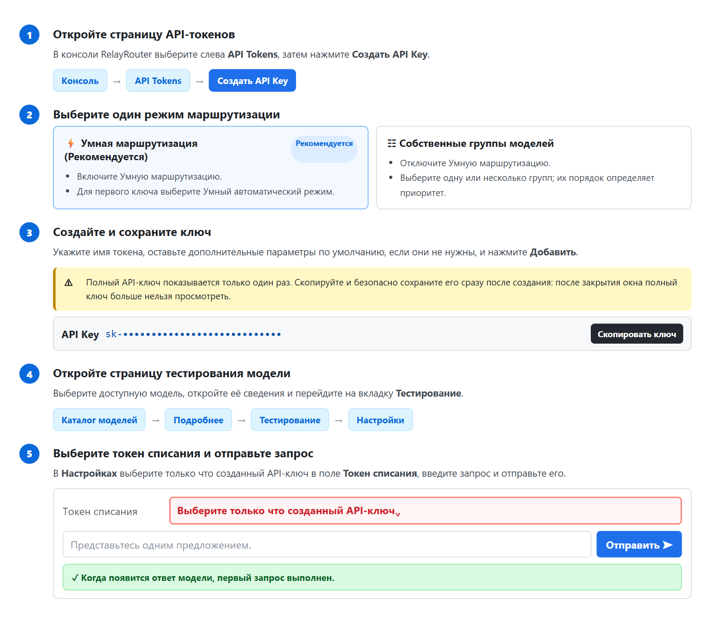
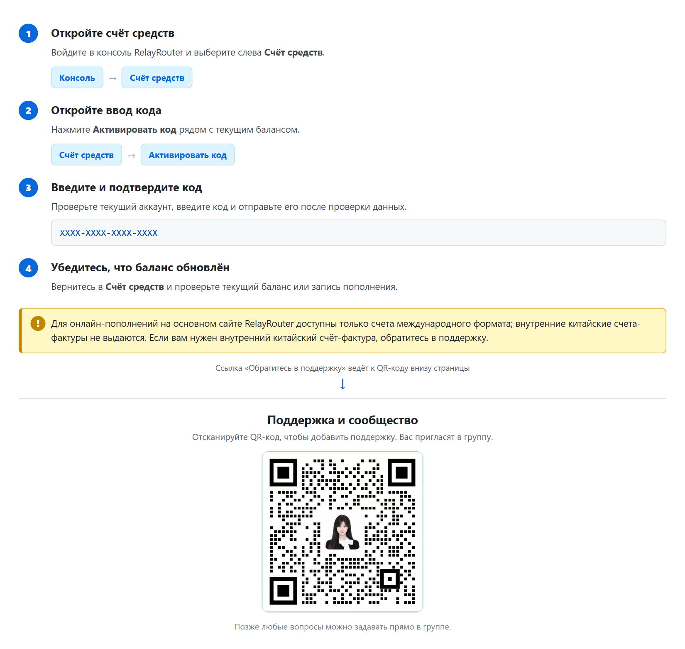
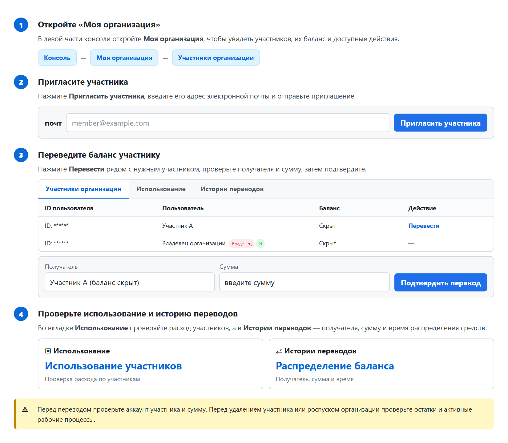

  <a lang="zh-CN" translate="no" href="./README.zh-CN.md">中文 (ZH)</a>
  &nbsp;|&nbsp;
  <a lang="en" translate="no" href="./README.md">English (EN)</a>
  &nbsp;|&nbsp;
  <strong><a lang="ru" translate="no" href="./README.ru.md">Русский (RU)</a></strong>
  &nbsp;|&nbsp;
  <a lang="ko" translate="no" href="./README.ko.md">한국어 (KO)</a>
  &nbsp;|&nbsp;
  <a lang="ja" translate="no" href="./README.ja.md">日本語 (JA)</a>
  &nbsp;|&nbsp;
  <a lang="es" translate="no" href="./README.es.md">Español (ES)</a>
  &nbsp;|&nbsp;
  <a lang="de" translate="no" href="./README.de.md">Deutsch (DE)</a>
  &nbsp;|&nbsp;
  <a lang="id" translate="no" href="./README.id.md">Bahasa Indonesia (ID)</a>

Текущий язык: Русский (RU). Если текст отображается на другом языке, отключите автоматический перевод для github.com.

  

  
  &nbsp;&nbsp;
  

  
  
  
  

> 💡 <strong>Подсказка:</strong> Поддерживается вход через сторонние сервисы. На странице регистрации нажмите Sign in внизу, затем выберите значок GitHub, Google или Linux DO.

<!-- relayrouter-announcements:start -->
> [!IMPORTANT]
> **Последние объявления · Автосинхронизация**
>
> Последние объявления RelayRouter (5):
>
> - `2026-11-18 17:08 (UTC+8)` — Модель на платформе: doubao-seedream-5-5-261028
> - `2026-11-18 16:33 (UTC+8)` — Модели на платформе: gpt-6.2-astra, gpt-6.2-sol
> - `2026-11-18 14:58 (UTC+8)` — Уведомление: gemini-4-carbon анти ресурсы ограничены, временно сняты с продажи группы анти ресурсов этой модели
> - `2026-11-17 22:46 (UTC+8)` — Уведомление: AWS-Gpt-1 Группа ресурсов испытывает нехватку, временно снята с продажи эта группа ресурсов
> - `2026-11-16 21:24 (UTC+8)` — Вывод модели: hy4-flash
>
> [Открыть RelayRouter и посмотреть все объявления →](https://relayrouter.app/register?aff=xc9N)
<!-- relayrouter-announcements:end -->

## Почему RelayRouter?

RelayRouter предоставляет единый API, совместимый с OpenAI, для работы с несколькими поставщиками моделей и сокращает повторяющуюся работу по интеграции.

| Возможность | Преимущество |
| --- | --- |
| Единый формат API | GPT, Claude, Gemini, DeepSeek, Qwen и другие поддерживаемые модели через знакомый интерфейс. |
| Оплата по использованию | Оплата фактического использования, записанного в консоли RelayRouter. |
| Централизованное управление | Ключи, модели, расход и оплата в одном месте. |
| Управление организацией | Создавайте организацию, приглашайте участников, распределяйте баланс и просматривайте расход и переводы. |
| Гибкие адреса подключения | Если клиент ожидает другой формат `BASE_URL`, адреса можно проверить по порядку. |

## Что вы хотите сделать?

Выберите цель и сразу перейдите к нужной инструкции — читать всю страницу по порядку не требуется.

| Цель | Цель |
| --- | --- |
| **[Выполнить первый API-запрос →](#first-api-call)** Около 5 минут · API-ключ → BASE_URL → первый запрос | **[Активировать код и проверить баланс →](#redeem-code)** Около 2 минут · Активировать средства и проверить баланс |
| **[Управлять командой или организацией →](#organization-management)** Около 8 минут · Создать → пригласить → распределить → проверить расход | **[Подключить клиент →](#client-integration)** ChatGPT, Claude, Cherry Studio, Gemini и DeepSeek Harness |

## Основные инструкции

<strong>🔑 Создание API-ключа и первый запрос</strong>

<!-- Source copy for the deterministic tutorial image:

#### 1. Откройте страницу API-токенов

В консоли RelayRouter выберите слева **API Tokens**, затем нажмите **Создать API Key**.

`Консоль` → `API Tokens` → **Создать API Key**

#### 2. Выберите один режим маршрутизации

| ⚡ Умная маршрутизация (Рекомендуется) | ☷ Собственные группы моделей |
| --- | --- |
| Включите **Умную маршрутизацию**. | Отключите **Умную маршрутизацию**. |
| Для первого ключа выберите **Умный автоматический режим**. | Выберите одну или несколько групп; их порядок определяет приоритет. |

#### 3. Создайте и сохраните ключ

Укажите имя токена, оставьте дополнительные параметры по умолчанию, если они не нужны, и нажмите **Добавить**.

> [!WARNING]
> Полный API-ключ показывается только один раз. Скопируйте и безопасно сохраните его сразу после создания: после закрытия окна полный ключ больше нельзя просмотреть.

`API Key`　`sk-****************************`　**Скопировать ключ**

#### 4. Откройте страницу тестирования модели

Выберите доступную модель, откройте её сведения и перейдите на вкладку **Тестирование**.

`Каталог моделей` → `Подробнее` → `Тестирование` → `Настройки`

#### 5. Выберите токен списания и отправьте запрос

В **Настройках** выберите только что созданный API-ключ в поле **Токен списания**, введите запрос и отправьте его.

> [!TIP]
> Когда появится ответ модели, первый запрос выполнен.

-->

<strong>🎁 Активация кода и проверка баланса</strong>

<strong><a href="#contact-support">Обратиться в поддержку</a></strong>

<!-- Source copy for the deterministic tutorial image:

#### 1. Откройте счёт средств

Войдите в консоль RelayRouter и выберите слева **Счёт средств**.

#### 2. Откройте ввод кода

Нажмите **Активировать код** рядом с текущим балансом.

#### 3. Введите и подтвердите код

Проверьте текущий аккаунт, введите код и отправьте его после проверки данных.

#### 4. Убедитесь, что баланс обновлён

Вернитесь в **Счёт средств** и проверьте текущий баланс или запись пополнения.

> [!IMPORTANT]
> Для онлайн-пополнений на основном сайте RelayRouter доступны только счета международного формата; внутренние китайские счета-фактуры не выдаются. Если вам нужен внутренний китайский счёт-фактура, [обратитесь в поддержку](#contact-support).

-->

<strong>👥 Управление участниками и расходом организации</strong>

<!-- Source copy for the deterministic tutorial image:

#### 1. Откройте «Моя организация»

В левой части консоли откройте **Моя организация**, чтобы увидеть участников, их баланс и доступные действия.

`Консоль` → `Моя организация` → `Участники организации`

#### 2. Пригласите участника

Нажмите **Пригласить участника**, введите его адрес электронной почты и отправьте приглашение.

`member@example.com`　**Пригласить участника**

#### 3. Переведите баланс участнику

Нажмите **Перевести** рядом с нужным участником, проверьте получателя и сумму, затем подтвердите.

| ID пользователя | Пользователь | Баланс | Действие |
| --- | --- | --- | --- |
| `ID: ******` | Участник A | Скрыт | **Перевести** |
| `ID: ******` | Владелец организации | Скрыт | — |

`Получатель: Участник A (баланс скрыт)`　`Сумма: введите сумму`　**Подтвердить перевод**

#### 4. Проверьте использование и историю переводов

Во вкладке **Использование** проверяйте расход участников, а в **Истории переводов** — получателя, сумму и время распределения средств.

> [!CAUTION]
> Перед переводом проверьте аккаунт участника и сумму. Перед удалением участника или роспуском организации проверьте остатки и активные рабочие процессы.

-->

## Подключение клиентов

Клиент может запрашивать базовый URL или полный адрес chat completions. Сначала используйте `https://api.relayrouter.app/v1`, а при другом формате смотрите [краткий справочник](#quick-reference).

<strong>Ярлык ChatGPT</strong>

В настройках поставщика выберите пользовательский или OpenAI-совместимый сервис, укажите API-ключ и адрес RelayRouter, затем выберите поддерживаемую модель.

<strong>Ярлык Claude</strong>

В настройках поставщика выберите пользовательский или OpenAI-совместимый сервис, укажите API-ключ и адрес RelayRouter, затем выберите поддерживаемую модель.

<strong>Cherry Studio</strong>

**Адрес API:** `https://api.relayrouter.app/v1`

1. Добавьте в Cherry Studio пользовательского OpenAI-совместимого поставщика.
2. Вставьте `BASE_URL` и API-ключ RelayRouter.
3. Добавьте поддерживаемую модель, сохраните настройки и отправьте тестовое сообщение.

<strong>Gemini</strong>

Для моделей Gemini через RelayRouter настройте пользовательского OpenAI-совместимого поставщика, укажите адрес и ключ RelayRouter, затем выберите поддерживаемый идентификатор Gemini.

<strong>DeepSeek Harness</strong>

Выберите OpenAI-совместимый адрес, укажите `BASE_URL` и API-ключ RelayRouter, затем выберите поддерживаемую модель DeepSeek и проверьте подключение.

## Краткий справочник

Разным клиентам может требоваться разный формат `BASE_URL`. Попробуйте адреса по порядку:

1. `https://api.relayrouter.app`
2. `https://api.relayrouter.app/v1`
3. `https://api.relayrouter.app/v1/chat/completions`

Примеры SDK в этом репозитории по умолчанию используют `https://api.relayrouter.app/v1`. Если клиент запрашивает полный адрес метода чата, используйте третий вариант.

## Готовые примеры

| Язык | Файл | Команда запуска |
| --- | --- | --- |
| Python | [`examples/python/chat.py`](./examples/python/chat.py) | `python examples/python/chat.py` |
| JavaScript | [`examples/javascript/chat.mjs`](./examples/javascript/chat.mjs) | `node examples/javascript/chat.mjs` |
| PowerShell | [`examples/powershell/request.ps1`](./examples/powershell/request.ps1) | `pwsh examples/powershell/request.ps1` |

## Документация и безопасность

- [Подробный быстрый старт](./docs/quickstart.md)
- [Частые вопросы](./docs/faq.md)
- [Устранение неполадок](./docs/troubleshooting.md)
- [Политика безопасности](./SECURITY.md)

Никогда не добавляйте API-ключ в Git. Храните его в `.env` или в менеджере секретов платформы.

<strong>Один API-ключ. Больше моделей. Меньше интеграций.</strong>

  

Отсканируйте QR-код, чтобы добавить контакт службы поддержки. Мы пригласим вас в пользовательскую группу, где можно напрямую задавать любые последующие вопросы.

