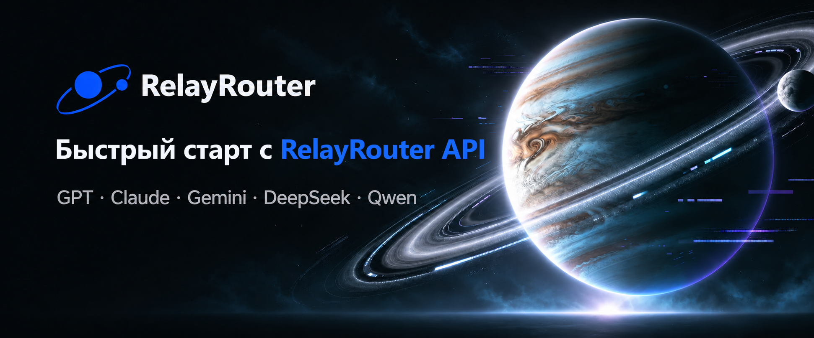
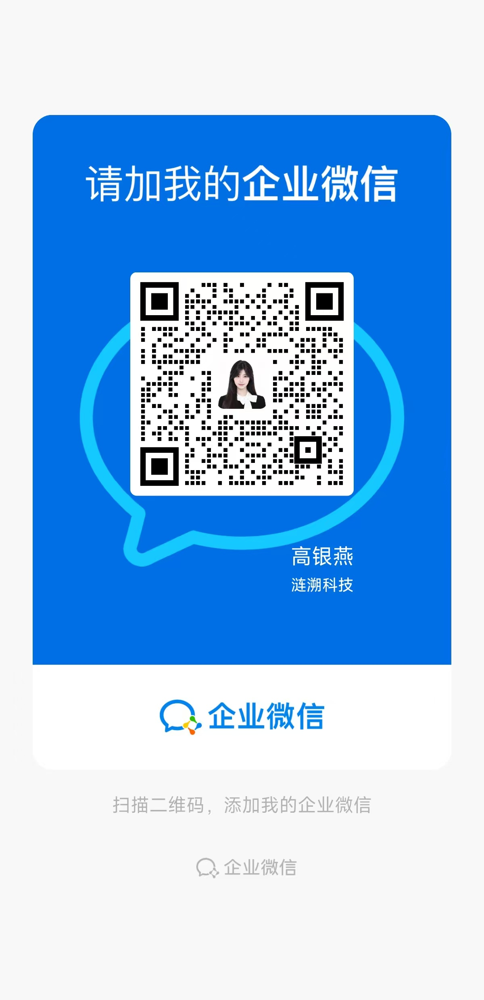

<div lang="ru" translate="no">

<p align="center">
  <a lang="zh-CN" translate="no" href="./README.zh-CN.md">中文 (ZH)</a>
  &nbsp;|&nbsp;
  <a lang="en" translate="no" href="./README.md">English (EN)</a>
  &nbsp;|&nbsp;
  <strong><a lang="ru" translate="no" href="./README.ru.md">Русский (RU)</a></strong>
  &nbsp;|&nbsp;
  <a lang="ko" translate="no" href="./README.ko.md">한국어 (KO)</a>
  &nbsp;|&nbsp;
  <a lang="ja" translate="no" href="./README.ja.md">日本語 (JA)</a>
  &nbsp;|&nbsp;
  <a lang="es" translate="no" href="./README.es.md">Español (ES)</a>
  &nbsp;|&nbsp;
  <a lang="de" translate="no" href="./README.de.md">Deutsch (DE)</a>
  &nbsp;|&nbsp;
  <a lang="id" translate="no" href="./README.id.md">Bahasa Indonesia (ID)</a>
</p>

<p align="center"><sub>Текущий язык: Русский (RU). Если текст отображается на другом языке, отключите автоматический перевод для github.com.</sub></p>

<p align="center">
  
</p>

<p align="center">
  <a href="https://relayrouter.app/register?aff=xc9N"></a>
  &nbsp;&nbsp;
  <a href="https://relayrouter.ai/register?aff=xc9N"></a>
</p>

<p align="center">
  
  
  
  
</p>

> 💡 <strong>Подсказка:</strong> Поддерживается вход через сторонние сервисы. На странице регистрации нажмите Sign in внизу, затем выберите значок GitHub, Google или Linux DO.

<!-- relayrouter-announcements:start -->
> [!IMPORTANT]
> **Последние объявления · Автосинхронизация**
>
> Последние объявления RelayRouter (5):
>
> - `2026-11-16 21:24 (UTC+8)` — Вывод модели: hy4-flash
> - `2026-11-15 10:46 (UTC+8)` — Уведомление: ресурсы gpt-6-luna codex ограничены, модель codex временно снята с продажи
> - `2026-11-13 22:12 (UTC+8)` — Модель доступна: gemini-4-hydrogen
> - `2026-11-12 18:11 (UTC+8)` — Уведомление: deepseek-1 Ресурсы группы на обслуживании, временно отключены, восстановление и уведомления будут позже
> - `2026-11-12 17:29 (UTC+8)` — Уведомление: модели серии jev находятся на обслуживании, временно отключены, восстановление и другие уведомления; Qwen/Qwen3-Reranker-0.6B, BAAI/bge-reranker-v2-m3, Pro/BAAI/bge-reranker-v2-m3, netease-youdao/bce-reranker-base_v1 будут отключены 12 ноября 202…
>
> [Открыть RelayRouter и посмотреть все объявления →](https://relayrouter.app/register?aff=xc9N)
<!-- relayrouter-announcements:end -->

## Почему RelayRouter?

RelayRouter предоставляет единый API, совместимый с OpenAI, для работы с несколькими поставщиками моделей и сокращает повторяющуюся работу по интеграции.

| Возможность | Преимущество |
| --- | --- |
| Единый формат API | GPT, Claude, Gemini, DeepSeek, Qwen и другие поддерживаемые модели через знакомый интерфейс. |
| Оплата по использованию | Оплата фактического использования, записанного в консоли RelayRouter. |
| Централизованное управление | Ключи, модели, расход и оплата в одном месте. |
| Управление организацией | Создавайте организацию, приглашайте участников, распределяйте баланс и просматривайте расход и переводы. |
| Гибкие адреса подключения | Если клиент ожидает другой формат `BASE_URL`, адреса можно проверить по порядку. |

## Что вы хотите сделать?

Выберите цель и сразу перейдите к нужной инструкции — читать всю страницу по порядку не требуется.

| Цель | Цель |
| --- | --- |
| **[Выполнить первый API-запрос →](#first-api-call)**<br><sub>Около 5 минут · API-ключ → BASE_URL → первый запрос</sub> | **[Активировать код и проверить баланс →](#redeem-code)**<br><sub>Около 2 минут · Активировать средства и проверить баланс</sub> |
| **[Управлять командой или организацией →](#organization-management)**<br><sub>Около 8 минут · Создать → пригласить → распределить → проверить расход</sub> | **[Подключить клиент →](#client-integration)**<br><sub>ChatGPT, Claude, Cherry Studio, Gemini и DeepSeek Harness</sub> |

## Основные инструкции

<a id="first-api-call"></a>
<details open>
<summary><strong>🔑 Создание API-ключа и первый запрос</strong></summary>

1. Зарегистрируйтесь через [relayrouter.app](https://relayrouter.app/register?aff=xc9N) или [relayrouter.ai](https://relayrouter.ai/register?aff=xc9N).
2. В консоли RelayRouter откройте **API Tokens**, создайте и скопируйте новый ключ.
3. Создайте локальный файл переменных окружения:

   ```bash
   cp .env.example .env
   ```

4. Заполните `.env`:

   ```dotenv
   RELAYROUTER_API_KEY=your_api_key_here
   RELAYROUTER_BASE_URL=https://api.relayrouter.app/v1
   RELAYROUTER_MODEL=your_model_name
   ```

5. Запустите пример на Python:

   ```bash
   python -m pip install -r requirements.txt
   python examples/python/chat.py
   ```

</details>

<a id="redeem-code"></a>
<details>
<summary><strong>🎁 Активация кода и проверка баланса</strong></summary>

1. Войдите в консоль RelayRouter.
2. Откройте раздел активации кода в настройках аккаунта или средств.
3. Введите код и подтвердите операцию после проверки аккаунта.
4. Вернитесь в раздел средств и проверьте баланс или запись операции.

</details>

<a id="organization-management"></a>
<details>
<summary><strong>👥 Управление участниками и расходом организации</strong></summary>

1. Откройте **Моя организация** и создайте организацию или присоединитесь к ней.
2. Нажмите **Пригласить участника** и отправьте приглашение нужному аккаунту.
3. Распределяйте или переводите баланс в списке участников.
4. Проверяйте вкладки **Использование** и **История переводов** для контроля расхода и движения средств.

> Предоставляйте доступ и баланс только доверенным аккаунтам.

</details>

<a id="client-integration"></a>
## Подключение клиентов

Клиент может запрашивать базовый URL или полный адрес chat completions. Сначала используйте `https://api.relayrouter.app/v1`, а при другом формате смотрите [краткий справочник](#quick-reference).

<details>
<summary><strong>Ярлык ChatGPT</strong></summary>

В настройках поставщика выберите пользовательский или OpenAI-совместимый сервис, укажите API-ключ и адрес RelayRouter, затем выберите поддерживаемую модель.

</details>

<details>
<summary><strong>Ярлык Claude</strong></summary>

В настройках поставщика выберите пользовательский или OpenAI-совместимый сервис, укажите API-ключ и адрес RelayRouter, затем выберите поддерживаемую модель.

</details>

<details open>
<summary><strong>Cherry Studio</strong></summary>

**Адрес API:** `https://api.relayrouter.app/v1`

1. Добавьте в Cherry Studio пользовательского OpenAI-совместимого поставщика.
2. Вставьте `BASE_URL` и API-ключ RelayRouter.
3. Добавьте поддерживаемую модель, сохраните настройки и отправьте тестовое сообщение.

</details>

<details>
<summary><strong>Gemini</strong></summary>

Для моделей Gemini через RelayRouter настройте пользовательского OpenAI-совместимого поставщика, укажите адрес и ключ RelayRouter, затем выберите поддерживаемый идентификатор Gemini.

</details>

<details>
<summary><strong>DeepSeek Harness</strong></summary>

Выберите OpenAI-совместимый адрес, укажите `BASE_URL` и API-ключ RelayRouter, затем выберите поддерживаемую модель DeepSeek и проверьте подключение.

</details>

<a id="quick-reference"></a>
## Краткий справочник

Разным клиентам может требоваться разный формат `BASE_URL`. Попробуйте адреса по порядку:

1. `https://api.relayrouter.app`
2. `https://api.relayrouter.app/v1`
3. `https://api.relayrouter.app/v1/chat/completions`

Примеры SDK в этом репозитории по умолчанию используют `https://api.relayrouter.app/v1`. Если клиент запрашивает полный адрес метода чата, используйте третий вариант.

## Готовые примеры

| Язык | Файл | Команда запуска |
| --- | --- | --- |
| Python | [`examples/python/chat.py`](./examples/python/chat.py) | `python examples/python/chat.py` |
| JavaScript | [`examples/javascript/chat.mjs`](./examples/javascript/chat.mjs) | `node examples/javascript/chat.mjs` |
| PowerShell | [`examples/powershell/request.ps1`](./examples/powershell/request.ps1) | `pwsh examples/powershell/request.ps1` |

## Документация и безопасность

- [Подробный быстрый старт](./docs/quickstart.md)
- [Частые вопросы](./docs/faq.md)
- [Устранение неполадок](./docs/troubleshooting.md)
- [Политика безопасности](./SECURITY.md)

Никогда не добавляйте API-ключ в Git. Храните его в `.env` или в менеджере секретов платформы.

<p align="center"><strong>Один API-ключ. Больше моделей. Меньше интеграций.</strong></p>

## Присоединиться к группе поддержки

Отсканируйте QR-код ниже, чтобы добавить контакт службы поддержки. Мы пригласим вас в пользовательскую группу, где можно напрямую задавать любые вопросы по использованию, настройке или интеграции.

<p align="center">
  
</p>

</div>
