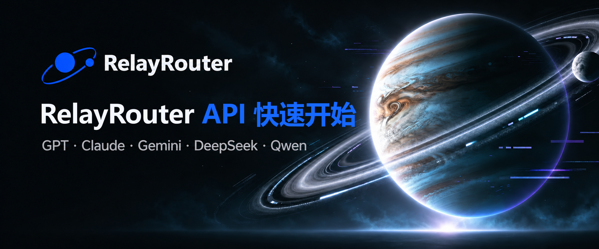

  <strong><a lang="zh-CN" translate="no" href="./README.zh-CN.md">中文 (ZH)</a></strong>
  &nbsp;|&nbsp;
  <a lang="en" translate="no" href="./README.md">English (EN)</a>
  &nbsp;|&nbsp;
  <a lang="ru" translate="no" href="./README.ru.md">Русский (RU)</a>
  &nbsp;|&nbsp;
  <a lang="ko" translate="no" href="./README.ko.md">한국어 (KO)</a>
  &nbsp;|&nbsp;
  <a lang="ja" translate="no" href="./README.ja.md">日本語 (JA)</a>
  &nbsp;|&nbsp;
  <a lang="es" translate="no" href="./README.es.md">Español (ES)</a>
  &nbsp;|&nbsp;
  <a lang="de" translate="no" href="./README.de.md">Deutsch (DE)</a>
  &nbsp;|&nbsp;
  <a lang="id" translate="no" href="./README.id.md">Bahasa Indonesia (ID)</a>

当前语言：中文（ZH）。如果正文仍显示为其他语言，请关闭浏览器对 github.com 的自动翻译。

  

  
  &nbsp;&nbsp;
  

  
  
  
  

> 💡 <strong>提示：</strong>支持第三方账号登录。进入注册页面后点击底部的 Sign in，在登录页面选择 GitHub、Google 或 Linux DO 图标，即可使用对应账号登录。

<!-- relayrouter-announcements:start -->
> [!IMPORTANT]
> **公告速知 · 自动同步**
>
> RelayRouter 最新 5 条公告：
>
> - `2026-11-18 17:08 (UTC+8)` — 模型上架：doubao-seedream-5-5-261028
> - `2026-11-18 16:33 (UTC+8)` — 模型上架：gpt-6.2-astra、gpt-6.2-sol
> - `2026-11-18 14:58 (UTC+8)` — 通知： gemini-4-carbon anti 资源紧缺，暂时下架该模型的 anti 资源分组
> - `2026-11-17 22:46 (UTC+8)` — 通知：AWS-Gpt-1分组资源紧缺，暂时下架该资源分组
> - `2026-11-16 21:24 (UTC+8)` — 模型上架：hy4-flash
>
> [进入 RelayRouter 查看全部公告 →](https://relayrouter.app/register?aff=xc9N)
<!-- relayrouter-announcements:end -->

## 为什么选择 RelayRouter？

RelayRouter 用一套兼容 OpenAI 的 API 连接多个模型服务商，让你少做重复接入，把更多时间留给产品。

| 能力 | 带来的好处 |
| --- | --- |
| 统一 API 格式 | 用熟悉的调用方式访问 GPT、Claude、Gemini、DeepSeek、Qwen 等已支持模型。 |
| 按量计费 | 按 RelayRouter 控制台记录的实际用量付费。 |
| 集中管理 | 在一个控制台管理 API 密钥、模型权限、用量与账单。 |
| 企业统一管理 | 创建组织、邀请成员、分配余额，并统一查看成员用量与余额划转记录。 |
| 灵活连接地址 | 当不同客户端要求不同的 `BASE_URL` 格式时，可按顺序尝试文档中的地址。 |

## 你想完成什么？

按目标进入对应教程，不必从头阅读整页文档。

| 目标 | 目标 |
| --- | --- |
| **[第一次调用 API →](#first-api-call)** 约 5 分钟 · API Key → BASE_URL → 首次请求 | **[兑换码与余额 →](#redeem-code)** 约 2 分钟 · 兑换额度并确认账户余额 |
| **[团队与企业管理 →](#organization-management)** 约 8 分钟 · 创建组织 → 邀请成员 → 分配余额 → 查看用量 | **[接入常用客户端 →](#client-integration)** ChatGPT、Claude、Cherry Studio、Gemini、DeepSeek Harness |

## 基础教程

<strong>🔑 创建 API Key 并完成首次请求</strong>

#### 1. 进入 API 令牌页面

打开 RelayRouter 控制台，在左侧选择 **API 令牌**，点击右上角 **创建 API Key**。

`控制台` → `API 令牌` → **创建 API Key**

#### 2. 选择一种路由模式

| ⚡ 智能路由（推荐） | ☷ 自选模型分组 |
| --- | --- |
| 开启 **智能路由**。 | 关闭 **智能路由**。 |
| 首次使用选择 **智能自动** 即可。 | 选择一个或多个模型分组，选择顺序即调用优先级。 |

#### 3. 创建并保存密钥

填写令牌名称，其他高级选项可先保持默认，然后点击 **添加**。

> [!WARNING]
> API Key 只完整显示一次。创建成功后请立即复制并安全保存；关闭弹窗后无法再次查看完整密钥。

`API Key`　`sk-****************************`　**复制密钥**

#### 4. 打开模型体验页

选择一个可用模型，进入详情页并切换到 **体验**。

`模型广场` → `查看详情` → `体验` → `设置`

#### 5. 选择扣费令牌并发送

在 **设置** 中选择刚创建的 API Key 作为 **扣费令牌**，输入问题后点击发送。

> [!TIP]
> 右侧出现模型回复，即表示首次请求完成。

<strong>🎁 兑换码兑换与余额确认</strong>

#### 1. 进入资金账户

登录 RelayRouter 控制台，在左侧菜单选择 **资金账户**。

#### 2. 打开兑换码入口

点击当前余额区域右侧的 **兑换码**，进入兑换窗口。

#### 3. 输入并确认兑换

核对当前账号后输入兑换码，确认信息无误再提交。

#### 4. 确认余额已经更新

返回 **资金账户**，查看当前余额或充值记录是否增加。

> [!IMPORTANT]
> RelayRouter 主站线上充值仅可开具国际形式发票，无国内发票。如需国内发票，请点击[联系客服](#contact-support)。

<strong>👥 企业组织成员与用量管理</strong>

#### 1. 进入“我的组织”

在控制台左侧打开 **我的组织**，查看组织成员、成员余额和可用操作。

`控制台` → `我的组织` → `组织成员`

#### 2. 邀请成员

点击右上角 **邀请成员**，输入成员邮箱并发送邀请。

`member@example.com`　**邀请成员**

#### 3. 向成员划转余额

在目标成员右侧点击 **划转**，核对成员与金额后确认。

| 用户 ID | 用户 | 余额 | 操作 |
| --- | --- | --- | --- |
| `ID: ******` | 成员 A | 已隐藏 | **划转** |
| `ID: ******` | 组织负责人 | 已隐藏 | — |

`划转给：成员 A（余额已隐藏）`　`划转金额：输入划转金额`　**确认划转**

#### 4. 查看用量与划转记录

切换到 **用量** 查看成员消耗；在 **划转记录** 中核对划转对象、金额与时间。

> [!CAUTION]
> 划转余额前请核对成员账号与金额；删除成员或解散组织前，请先确认余额和正在使用的业务。

## 客户端接入教程

不同客户端可能要求填写基础地址或完整的聊天补全地址。建议先使用 `https://api.relayrouter.app/v1`；如果格式不匹配，请查看下方[快速参考](#quick-reference)。

<strong>ChatGPT 快捷方式</strong>

打开快捷方式的服务商设置，选择自定义或 OpenAI 兼容服务商，填写 RelayRouter API Key 和接口地址，再选择已支持的模型。

<strong>Claude 快捷方式</strong>

打开快捷方式的服务商设置，选择自定义或 OpenAI 兼容服务商，填写 RelayRouter API Key 和接口地址，再选择已支持的模型。

<strong>Cherry Studio</strong>

**API 端点：** `https://api.relayrouter.app/v1`

1. 在 Cherry Studio 中添加自定义 OpenAI 兼容服务商。
2. 填写 `BASE_URL` 和 RelayRouter API Key。
3. 添加已支持的模型，保存配置后发送测试消息。

<strong>Gemini</strong>

如需通过 RelayRouter 调用 Gemini 模型，请在支持自定义服务商的客户端中选择 OpenAI 兼容模式，填写 RelayRouter 接口地址与密钥，再选择已支持的 Gemini 模型标识。

<strong>DeepSeek Harness</strong>

将 Harness 服务商设为 OpenAI 兼容端点，填写 RelayRouter `BASE_URL` 与 API Key，选择已支持的 DeepSeek 模型后进行连接测试。

## 快速参考

不同客户端可能需要不同的 `BASE_URL`，建议依次尝试以下地址：

1. `https://api.relayrouter.app`
2. `https://api.relayrouter.app/v1`
3. `https://api.relayrouter.app/v1/chat/completions`

本仓库中的 SDK 示例默认使用 `https://api.relayrouter.app/v1`。如果客户端要求填写完整的聊天补全接口，而不是基础地址，请使用第三个地址。

## 可直接运行的示例

| 语言 | 文件 | 运行命令 |
| --- | --- | --- |
| Python | [`examples/python/chat.py`](./examples/python/chat.py) | `python examples/python/chat.py` |
| JavaScript | [`examples/javascript/chat.mjs`](./examples/javascript/chat.mjs) | `node examples/javascript/chat.mjs` |
| PowerShell | [`examples/powershell/request.ps1`](./examples/powershell/request.ps1) | `pwsh examples/powershell/request.ps1` |

## 文档与帮助

- [详细快速开始](./docs/quickstart.md)
- [常见问题](./docs/faq.md)
- [故障排查](./docs/troubleshooting.md)
- [安全政策](./SECURITY.md)

## 安全提示

不要把 API 密钥提交到 Git。请将密钥保存在 `.env` 或部署平台的密钥管理器中；仓库内的 `.gitignore` 已默认忽略 `.env`。

<strong>一个 API 密钥，连接更多模型，减少重复接入。</strong>

  

扫码添加客服，我们会邀请你加入交流群。后续遇到任何问题，都可以直接在群里提问。

